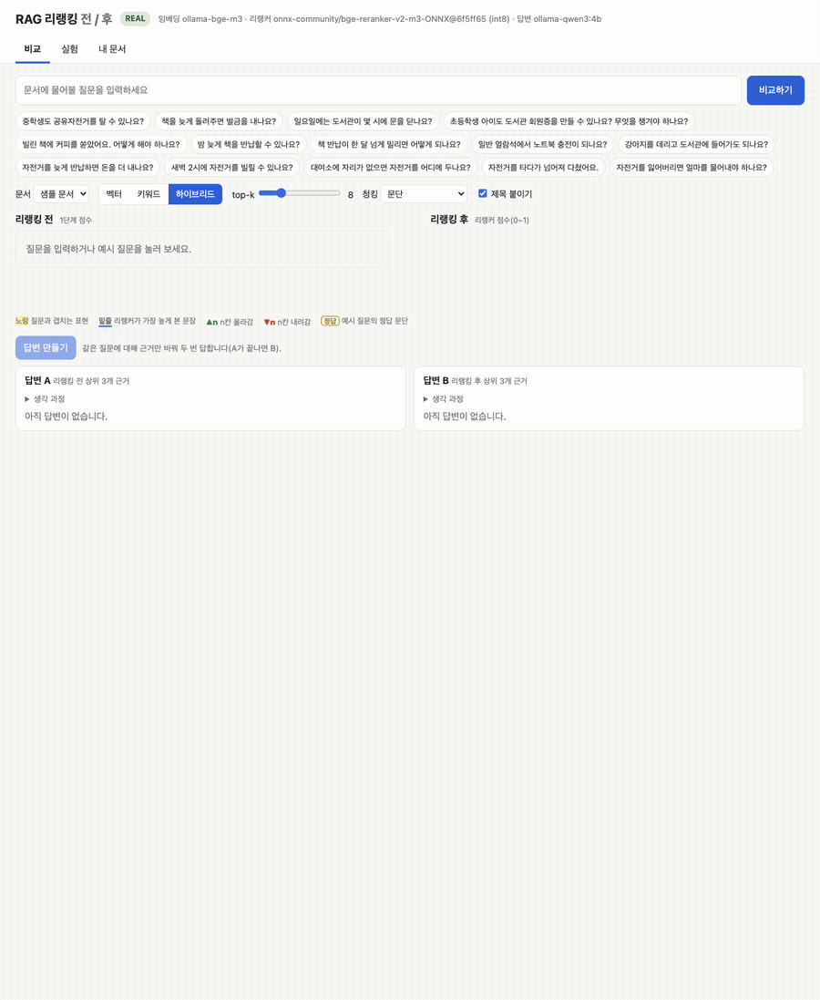
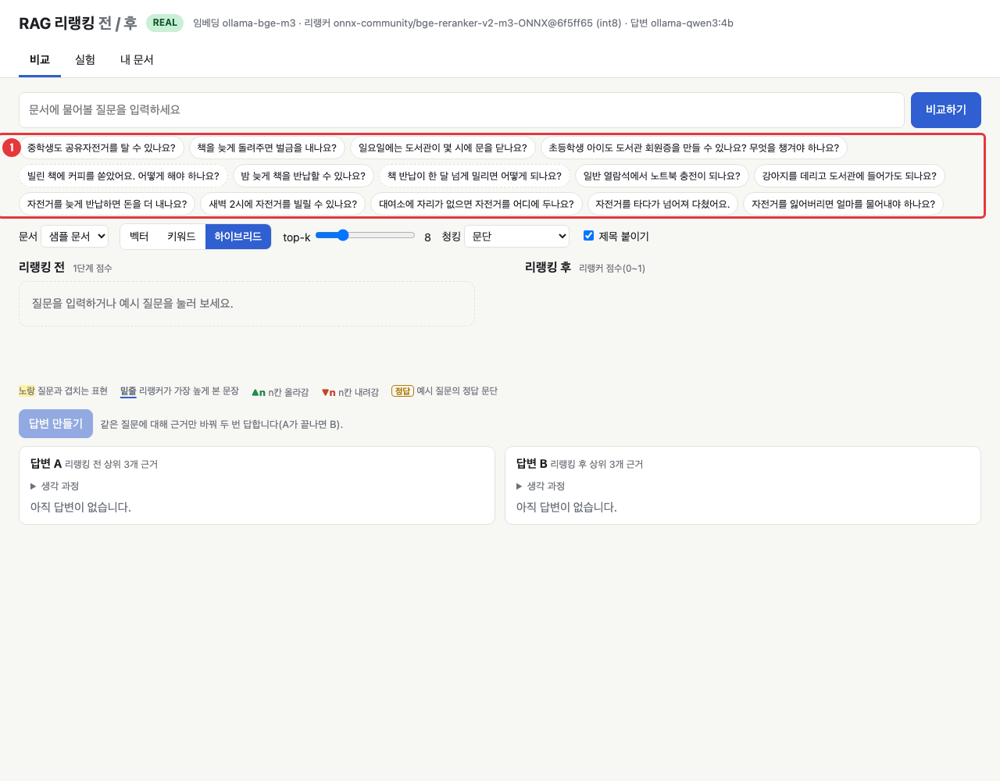
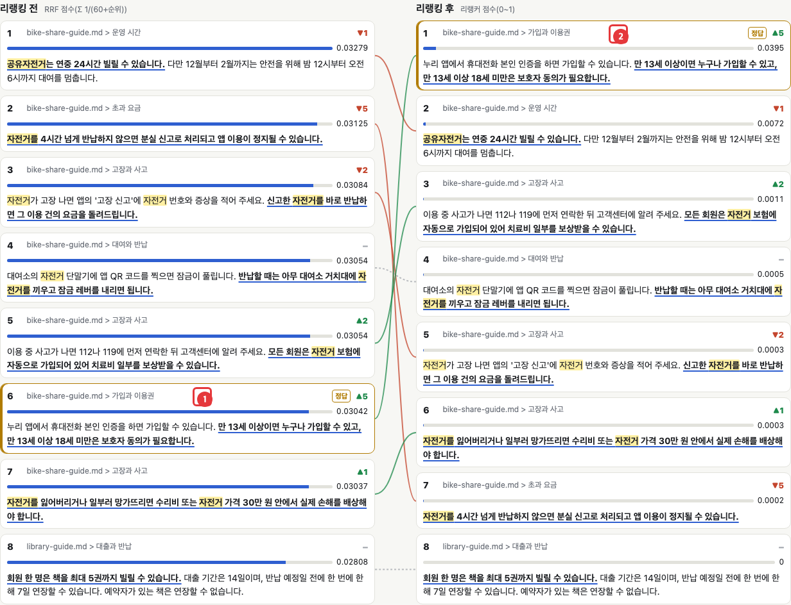
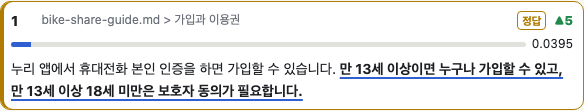
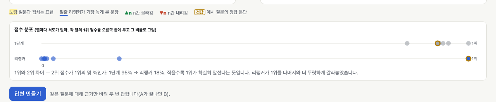
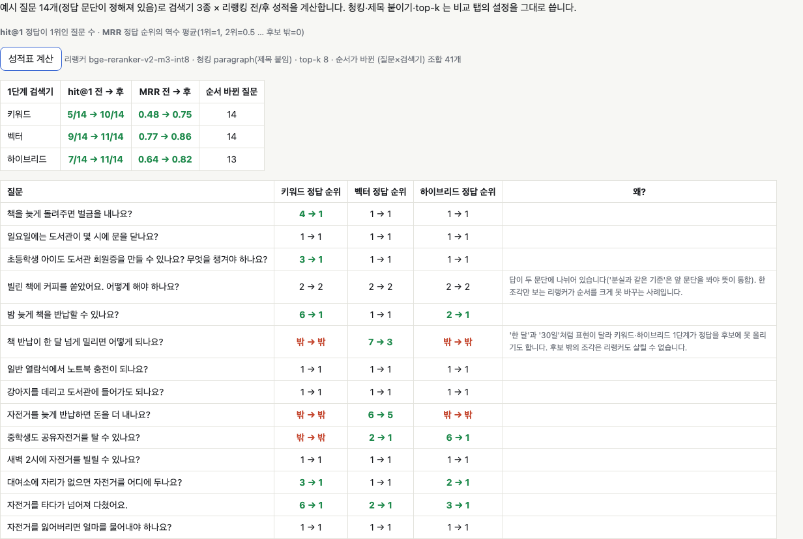
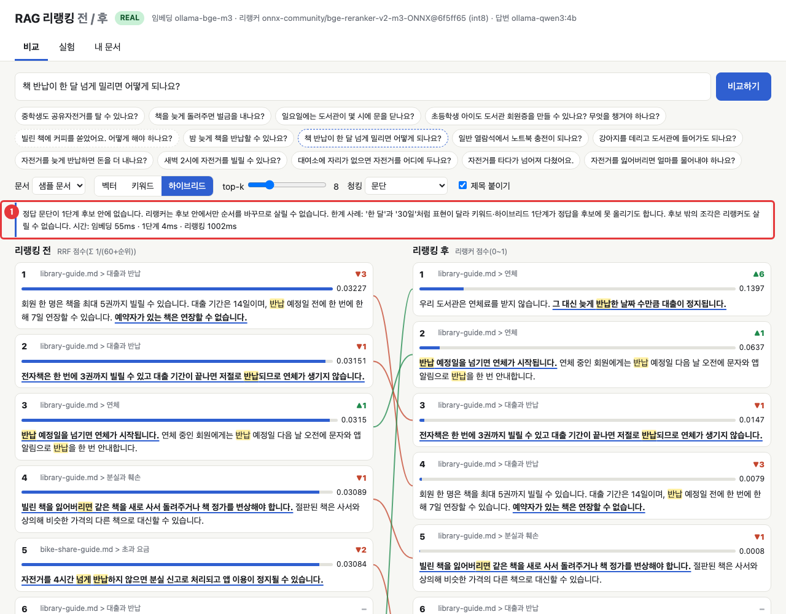
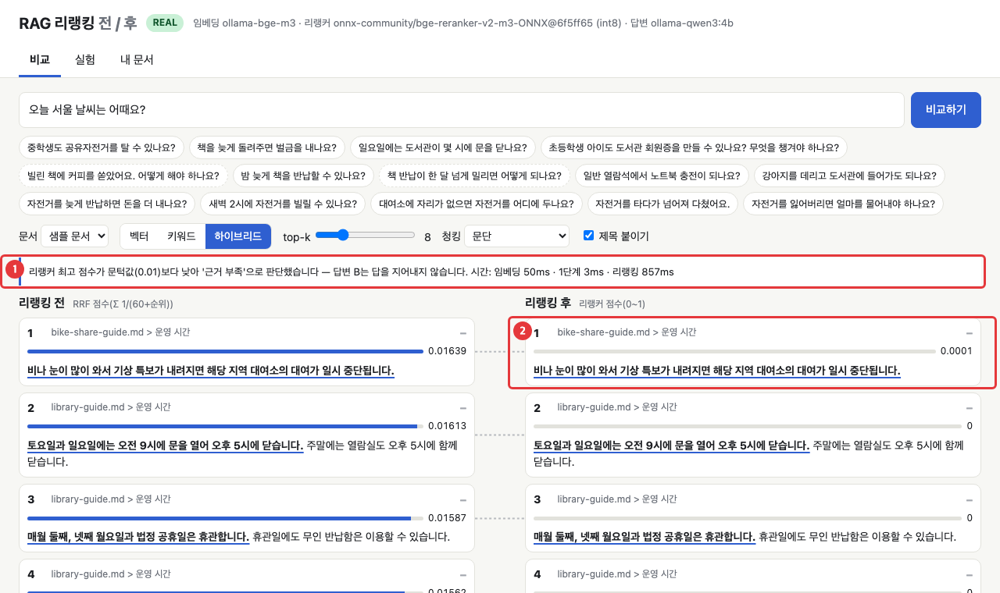
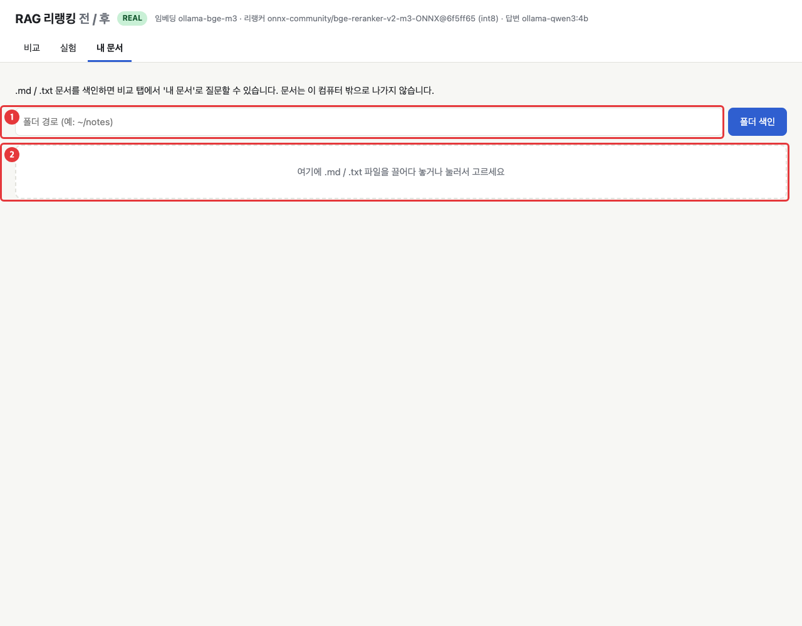
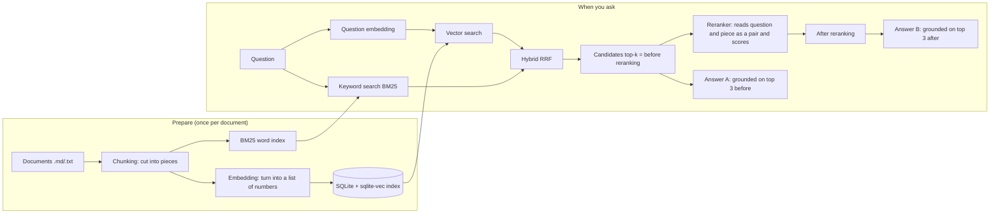

# RAG Reranking Before/After — See How Document Search Changes the Answer

[한국어](README.md) | **English**

A local, keyless demo that walks through RAG (retrieval-augmented generation): chunking, embeddings, vector / keyword / hybrid search and a grounded answer. Its centerpiece is a before/after view that shows how a cross-encoder reranker reorders the retrieved passages and changes the final answer. Run it with `uv run rag-rerank`; without Ollama it falls back to a deterministic mock mode that needs no network and still reproduces the key before/after scene (with different numbers).


<sub>Click an example question and the correct passage that was 6th on the left (before reranking) moves up to 1st on the right (after reranking). Green lines mark cards that moved up, red lines cards that moved down. (Real mode, recorded on a MacBook M3 16GB)</sub>

## One-line summary

Run **RAG** yourself — split documents into pieces, search them, and answer from what was found — and compare on one screen how a single **reranking (re-sorting)** step changes the ranking and the answer.

**Who this is for:**
- People who have heard of RAG but don't know what happens inside
- People who want a feel for what to fix when search results look off
- People who want to experiment with their own documents (`.md`, `.txt`)

## Why should you care?

Say you ask a librarian, "Can a middle schooler ride a shared bike?" The librarian quickly pulls 20 books from the shelves that look relevant. In the rush, though, the operating-hours notice that mentions "shared bike" many times ends up on top, while the sign-up guide that actually says "anyone aged 13 or older" sits at 6th.

So the librarian lays the 20 books out next to your question and **reads them one by one, carefully, and ranks them again.** That second step is reranking. The first step is fast but rough; the second is slow but accurate. When an AI model writes an answer it reads only the top few passages as evidence, so whether the right passage is 6th or 1st decides whether the answer is "I don't know" or a correct one. This demo shows exactly that difference.

## Run it in 30 seconds

You need `git` and [uv](https://docs.astral.sh/uv/) (a Python runner and package manager). uv downloads Python 3.14 for you, so you don't need to install Python separately. [Ollama](https://ollama.com) is needed only when running with real models. No API key is required.

```bash
# Install uv (once). macOS / Linux:
curl -LsSf https://astral.sh/uv/install.sh | sh
# or macOS: brew install uv / Windows(PowerShell): winget install --id=astral-sh.uv -e
# If you don't have git: macOS: xcode-select --install / Ubuntu·Debian: sudo apt install git
```

```bash
git clone https://github.com/LeeGyeongPil/ai-lab-rag-rerank.git
cd ai-lab-rag-rerank
uv run rag-rerank --mock
```

The terminal prints a `화면: http://127.0.0.1:8765` line ("화면" = "screen") and a browser opens. On a headless server, over SSH or in a container where no browser can open, open that address yourself. To keep the browser from opening automatically, run `uv run rag-rerank --mock --no-browser` (or set `RAG_NO_BROWSER=1`). If you run inside Docker, see [Troubleshooting](#troubleshooting).

`--mock` is the **practice mode**. It uses no network and no model; fake embeddings, a fake reranker and a fake answer (which copies a sentence from the evidence verbatim) always produce exactly the same result. The fake models imitate "same meaning, different wording" with a small hand-made thesaurus tuned to the sample documents (for example `중학생` (middle schooler) ↔ `만 13세` (age 13 or older)), so **the scene where reranking lifts the correct passage is visible in mock mode too.** However, the score and rank numbers and the answer sentences differ from real mode and say nothing about search quality (a `MOCK` badge appears on screen). The actual mock output is pasted in [Follow along in practice (mock) mode](#follow-along-in-practice-mock-mode).

To try real models, install Ollama and then:

```bash
ollama pull bge-m3      # embedding model that turns documents and questions into numbers (about 1.2GB)
ollama pull qwen3:4b    # model that writes the answer (about 2.5GB)
uv run rag-rerank       # automatically uses real mode when Ollama and the models are found
```

The first comparison downloads the reranker model (about 588MB) once. From an empty state, including dependency installation and the reranker download, the first comparison result appeared after 26 seconds (measured with `scripts/first_run.sh`, fast network, with the uv package cache warm). **Every screenshot in this document and every output starting with `[REAL]` is real-mode output.** Mock-mode output is in a [separate section below](#follow-along-in-practice-mock-mode).


<sub>The first screen. The green badge at the top shows the current mode (REAL or MOCK), 1 marks the 14 example questions you can click, and below them you choose the stage-1 retriever (vector, keyword, hybrid). Buttons with dotted borders are "limit cases" that reranking struggles with.</sub>

If you prefer the terminal only, you can see the same comparison as text. The following is **real-mode** output (for mock, add `--mock` at the end; its result is in the next section).

```bash
uv run rag-rerank ask "책을 늦게 돌려주면 벌금을 내나요?" --retriever keyword
```

```text
[REAL] Ollama와 모델이 준비되어 실제 모드로 실행합니다.
질문: 책을 늦게 돌려주면 벌금을 내나요?
검색기: keyword · top-k 8 · 청킹 paragraph(제목 붙임) · 색인 33개 청크

리랭킹 전  [BM25 점수(상한 없음)]
  순위  점수      이동  출처 / 내용
    1   8.1094    ▼1    library-guide.md > 분실과 훼손 | 빌린 책을 잃어버리면 같은 책을 새로 사서 돌려주거나 책 정가를 변…
    2   7.7518    ▼2    bike-share-guide.md > 안전 | 헬멧은 대여소 옆 헬멧 보관함에서 무료로 빌릴 수 있습니다. 쓴 헬…
    3   5.2221    ▼2    bike-share-guide.md > 고장과 사고 | 자전거가 고장 나면 앱의 '고장 신고'에 자전거 번호와 증상을 적어…
    4   3.5029    ▲3    library-guide.md > 연체 | 우리 도서관은 연체료를 받지 않습니다. 그 대신 늦게 반납한 날짜 …
    ...

리랭킹 후  [리랭커 점수(0~1)]
  순위  점수      이동  전순위  출처 / 내용
    1   0.0308    ▲3       4    library-guide.md > 연체 | 우리 도서관은 연체료를 받지 않습니다. 그 대신 늦게 반납한 날짜 …
    2   0.0023    ▼1       1    library-guide.md > 분실과 훼손 | 빌린 책을 잃어버리면 같은 책을 새로 사서 돌려주거나 책 정가를 변…
    ...
1위와 2위 차이: 2위 점수가 1위의 96%(1단계) → 7%(리랭커) — 작을수록 1위가 확실히 앞섬

시간(ms): 임베딩 0 · 1단계 0 · 리랭킹 747
```

(The question means "Do I pay a fine if I return a book late?". `...` marks lines trimmed for space. The correct passage ("our library does not charge late fees"), 4th after keyword-search stage 1, becomes 1st after reranking.)

## Follow along in practice (mock) mode

Even without Ollama, `--mock` alone reproduces everything below. The output was pasted from a real run in this repository, and because mock is deterministic you get the same numbers on any computer.

**1) Start the screen**

```bash
uv run rag-rerank --mock --no-browser
```

```text
[MOCK] --mock 플래그(또는 RAG_MODE=mock)로 mock 모드를 켰습니다.
화면: http://127.0.0.1:8765  (끝내려면 Ctrl+C)
```

Open this address in a browser and click the first example question, `중학생도 공유자전거를 탈 수 있나요?` ("Can a middle schooler ride a shared bike too?"). The correct passage (`만 13세 이상이면 누구나 …`, "anyone aged 13 or older …") moves from 6th on the left (before reranking) to 1st on the right (after reranking) and gets a `▲5` badge. The movement is the same as in the real-mode screenshot, and the reranker score is 0.4292 versus 0.0395 in real mode. Click `답변 만들기` ("Create answers") and answers A and B appear immediately.

**2) See the same comparison in the terminal**

```bash
uv run rag-rerank ask "중학생도 공유자전거를 탈 수 있나요?" --mock
```

```text
[MOCK] --mock 플래그(또는 RAG_MODE=mock)로 mock 모드를 켰습니다.
질문: 중학생도 공유자전거를 탈 수 있나요?
검색기: hybrid · top-k 8 · 청킹 paragraph(제목 붙임) · 색인 33개 청크

리랭킹 전  [RRF 점수(Σ 1/(60+순위))]
  순위  점수      이동  출처 / 내용
    1   0.032     ▼3    bike-share-guide.md > 고장과 사고 | 자전거를 잃어버리거나 일부러 망가뜨리면 수리비 또는 자전거 가격 3…
    2   0.03151   ▼3    bike-share-guide.md > 고장과 사고 | 자전거가 고장 나면 앱의 '고장 신고'에 자전거 번호와 증상을 적어…
    3   0.03125   –     bike-share-guide.md > 초과 요금 | 자전거를 4시간 넘게 반납하지 않으면 분실 신고로 처리되고 앱 이용…
    4   0.03058   ▼3    library-guide.md > 회원증 | 회원증을 잃어버리면 재발급 수수료 없이 다시 만들 수 있습니다. 모…
    5   0.02955   ▲3    bike-share-guide.md > 운영 시간 | 공유자전거는 연중 24시간 빌릴 수 있습니다. 다만 12월부터 2월…
    6   0.02944   ▲5    bike-share-guide.md > 가입과 이용권 | 누리 앱에서 휴대전화 본인 인증을 하면 가입할 수 있습니다. 만 1…
    7   0.02938   ▼1    library-guide.md > 분실과 훼손 | 빌린 책을 잃어버리면 같은 책을 새로 사서 돌려주거나 책 정가를 변…
    8   0.02927   ▲2    bike-share-guide.md > 대여와 반납 | 대여소의 자전거 단말기에 앱 QR 코드를 찍으면 잠금이 풀립니다. …

리랭킹 후  [리랭커 점수(0~1)]
  순위  점수      이동  전순위  출처 / 내용
    1   0.4292    ▲5       6    bike-share-guide.md > 가입과 이용권 | 누리 앱에서 휴대전화 본인 인증을 하면 가입할 수 있습니다. 만 1…
    2   0.3586    ▲3       5    bike-share-guide.md > 운영 시간 | 공유자전거는 연중 24시간 빌릴 수 있습니다. 다만 12월부터 2월…
    3   0.2008    –        3    bike-share-guide.md > 초과 요금 | 자전거를 4시간 넘게 반납하지 않으면 분실 신고로 처리되고 앱 이용…
    4   0.1671    ▼3       1    bike-share-guide.md > 고장과 사고 | 자전거를 잃어버리거나 일부러 망가뜨리면 수리비 또는 자전거 가격 3…
    5   0.1671    ▼3       2    bike-share-guide.md > 고장과 사고 | 자전거가 고장 나면 앱의 '고장 신고'에 자전거 번호와 증상을 적어…
    6   0.1671    ▲2       8    bike-share-guide.md > 대여와 반납 | 대여소의 자전거 단말기에 앱 QR 코드를 찍으면 잠금이 풀립니다. …
    7   0.0708    ▼3       4    library-guide.md > 회원증 | 회원증을 잃어버리면 재발급 수수료 없이 다시 만들 수 있습니다. 모…
    8   0.0708    ▼1       7    library-guide.md > 분실과 훼손 | 빌린 책을 잃어버리면 같은 책을 새로 사서 돌려주거나 책 정가를 변…

1위와 2위 차이: 2위 점수가 1위의 98%(1단계) → 84%(리랭커) — 작을수록 1위가 확실히 앞섬

시간(ms): 임베딩 0 · 1단계 0 · 리랭킹 0

답변 A (리랭킹 전 상위 3개 근거): 근거에 따르면 자전거를 잃어버리거나 일부러 망가뜨리면 수리비 또는 자전거 가격 30만 원 안에서 실제 손해를 배상해야 합니다. [1]
  인용: [1]=bike-share-guide#11

답변 B (리랭킹 후 상위 3개 근거): 근거에 따르면 만 13세 이상이면 누구나 가입할 수 있고, 만 13세 이상 18세 미만은 보호자 동의가 필요합니다. [1]
  인용: [1]=bike-share-guide#0
```

How to read it:
- The correct passage rises from 6th in stage 1 to 1st after reranking (`▲5`). This is the core scene of the demo.
- Answer A copies the off-topic top passage from before reranking (bike damage compensation), while answer B cites the `만 13세 이상` ("age 13 or older") sentence of the correct passage as `[1]`. The mock answer is not written by a model; it copies, from evidence 1, the sentence that overlaps most with the question. So unlike real mode, it does not say "no evidence found" and just copies the wrong evidence. The point is the same: **wrong evidence gives a wrong answer.**
- The "gap between 1st and 2nd" shrinks only from 98% to 84%, less than real mode (95% → 18%). The fake reranker score only looks at how much of the question's wording is present, so it cannot separate the top result by much.
- Time always prints as 0 in mock (to keep "same input → same output").

The keyword-search example from the previous section (`책을 늦게 돌려주면 벌금을 내나요?` `--retriever keyword --mock`) also lifts the correct passage from 4th to 1st in mock, and answer B is "근거에 따르면 우리 도서관은 연체료를 받지 않습니다. [1]" ("According to the evidence, our library does not charge late fees. [1]") (scores differ from real mode).

**3) Scorecard**

```bash
uv run rag-rerank eval --mock
```

```text
[MOCK] --mock 플래그(또는 RAG_MODE=mock)로 mock 모드를 켰습니다.
성적표 — 질문 14개, top-k 8, 리랭커 mock-overlap
  검색기    hit@1 전→후    MRR 전→후        순서 바뀐 질문
  keyword    5/14 →  8/14   0.48 → 0.64      9
  vector     5/14 →  8/14   0.51 → 0.68      14
  hybrid     4/14 →  9/14   0.50 → 0.72      13

순서가 바뀐 (질문 × 검색기) 조합: 36
```

The numbers differ from real mode ([step 5](#step-5-check-with-the-scorecard-that-it-was-not-luck)). The mock thesaurus was **made on purpose** so the reranking scene shows up in the example questions, so this table is not evidence that reranking works; it is practice for getting used to the screen flow. To see how much reranking really helps, check the real-mode scorecard in step 5 (hybrid hit@1 7/14 → 11/14). The **실험** ("Experiment") tab of the web screen opened with mock also shows the practice numbers above.

**4) Limit cases and insufficient evidence**

- `책 반납이 한 달 넘게 밀리면 어떻게 되나요?` ("What happens if a book return is more than a month overdue?") also has no correct passage within the 8 stage-1 candidates in mock, so the notice "정답 문단이 1단계 후보 안에 없습니다" ("the correct passage is not among the stage-1 candidates") appears (the same scene as [step 6](#step-6-see-what-the-reranker-cannot-fix)).
- `오늘 서울 날씨는 어때요?` ("What's the weather in Seoul today?") also ends in "insufficient evidence" in mock. The mock reranker uses a **fixed threshold of 0.1** matched to its fake scores (unlike 0.01 in real mode, and not affected by `RAG_MIN_RERANK_SCORE`).

```bash
uv run rag-rerank ask "오늘 서울 날씨는 어때요?" --mock
```

```text
...
※ 리랭커 최고 점수가 문턱값보다 낮아 '근거 부족'으로 판단했습니다.

시간(ms): 임베딩 0 · 1단계 0 · 리랭킹 0

답변 A (리랭킹 전 상위 3개 근거): 근거에 따르면 시각장애인 안내견을 제외한 반려동물은 도서관 건물 안에 들어올 수 없습니다. [1]
  인용: [1]=library-guide#18

답변 B (리랭킹 후 상위 3개 근거): 문서에서 근거를 찾지 못했습니다.
  인용: 없음
```

(`...` marks lines trimmed for space. When evidence is insufficient, only answer B skips the model and replies "문서에서 근거를 찾지 못했습니다." ("No evidence was found in the documents."). For comparison, answer A still answers from the pre-reranking evidence as is, so it copies an unrelated sentence.)

## Step by step

> Every screenshot, number and answer in this section comes from **real mode** (Ollama + reranker model). If you opened with `--mock`, the screen layout and the direction in which the correct answer moves are the same, but score and rank numbers and answer sentences differ. Compare with the mock results in the [section just above](#follow-along-in-practice-mock-mode).

### Step 1. Click an example question to see the two lists side by side

Click the first example question, `중학생도 공유자전거를 탈 수 있나요?` ("Can a middle schooler ride a shared bike too?"). The retriever is the default **hybrid**, and the number of candidates to fetch (top-k) is 8. Within 1–2 seconds the left (before reranking) and right (after reranking) lists appear and the cards slide into place.


<sub>The card marked 1 was 6th before reranking; the card marked 2 is the same passage after it moved up to 1st. The `▲5` badge at the top right of a card means "moved up 5 places", and the line in the middle connects the same card.</sub>

How to read it:
- The left is the order assigned by stage-1 search, the right is the order the reranker assigned again.
- `▲5` means up 5 places, `▼1` down 1 place, `–` unchanged.
- The gold border and the `정답` ("correct answer") label appear only for the example questions, on the passage fixed in advance as correct. With your own documents the answer is unknown, so nothing is marked.
- **The scores in the two columns are on different scales.** The left is the hybrid RRF score (clustered between 0.028 and 0.033), the right is the reranker score (0 to 1). Don't compare bar lengths across columns.

### Step 2. Check the evidence sentence

Inside each card, the **yellow fill** marks wording that shares characters with the question, and **underline + bold** marks the sentence the reranker picked as "closest to the question."


<sub>The 1st-place card after reranking. The question contains both "공유자전거" (shared bike) and "탈 수" (can ride), but the reranker picked "만 13세 이상이면 누구나 가입할 수 있고" ("anyone aged 13 or older can sign up, and"), which shares no characters, as the evidence sentence. The reranker score is 0.0395.</sub>

A reranker score as small as 0.0395 can still be 1st. The score is not "the probability of being correct" but a relative score for comparing candidates with each other. Trust the order and don't worry much about the absolute value.

### Step 3. See how clear the top result is

Below the comparison screen is a score-distribution chart. The top row is the stage-1 score and the bottom row is the reranker score; each dot is one candidate. The two rows use different score meanings (scales), so **each row's top score is placed at the right end (`1위`, "1st") and the rest are drawn in proportion to it.** The dot with a gold border is the correct passage.


<sub>In the stage-1 (hybrid) row, the 8 dots are bunched near 1st, so 1st barely stands out from the rest. In the reranker row only 1st (the correct one, with the gold border) is at the right end and the others are far away. The sentence under the chart summarizes: "1위와 2위 차이 — 2위 점수가 1위의 몇 %인가: 1단계 95% → 리랭커 18%" ("gap between 1st and 2nd — 2nd's score as a percentage of 1st's: stage 1 95% → reranker 18%").</sub>

How to read it: **the smaller "2nd's score as a percentage of 1st's" is, the more clearly 1st leads.** In stage 1, 2nd is 95% of 1st, close to a tie; after the reranker it shrinks to 18% and the correct passage separates clearly from the rest. With near-equal scores the order flips easily over trivial differences, so stage-1 scores alone make the top spot hard to trust, and that is why reranking is needed. The same information appears in the terminal `ask` result as the "1위와 2위 차이" line.

### Step 4. Compare answers A and B

Click `답변 만들기` ("Create answers") and the model answers twice for **the same question with only the evidence swapped.** Answer A reads the top 3 before reranking as evidence, and answer B reads the top 3 after reranking. B starts only after A finishes.

![Answer A: '문서에서 근거를 찾지 못했습니다', answer B: a correct answer with citation [1]](docs/images/05-answers.png)
<sub>Answer A (pre-reranking evidence) says "문서에서 근거를 찾지 못했습니다." ("No evidence was found in the documents."), and answer B (post-reranking evidence) says "중학생이 만 13세 이상이면 가입할 수 있으나, 만 13세 이상 18세 미만은 보호자 동의가 필요합니다. [1]" ("A middle schooler can sign up if aged 13 or older, but ages 13 to under 18 need a guardian's consent. [1]").</sub>

A, whose correct passage was outside the top 3 (6th), says it found no evidence; B, where it became 1st, answers correctly and attaches a number such as `[1]` showing **which evidence the statement came from**. `생각 239토큰` ("thought 239 tokens") is how much this model thought to itself before answering (the content is collapsed).

Answers are slow. On this MacBook (M3 16GB), A and B together took about 4 minutes (a value from when Ollama was shared with other work; one answer usually takes tens of seconds to 2 minutes). The comparison screen appears first, answers start only when you click the button, and the `중지` ("Stop") button can interrupt them. If you need faster answers, see item 4 of [Try changing things yourself](#try-changing-things-yourself).

### Step 5. Check with the scorecard that it was not luck

Something working on one question may be chance, so in the **실험** ("Experiment") tab all 14 example questions are run through the 3 retrievers and scored before/after reranking (about 14 seconds).


<sub>The upper table summarizes by retriever; the lower table shows, per question, how the rank of the correct passage changed. Green is improvement; a red `밖 → 밖` ("outside → outside") means stage 1 did not even bring it into the candidates.</sub>

- **hit@1**: how many questions have the correct answer at 1st (out of 14).
- **MRR**: the average of the reciprocal of the correct rank. 1 for 1st, 0.5 for 2nd, 0 if outside the candidates.
- **Questions whose order changed**: the number of questions (out of 14) where the order of the 8 candidates differs by even one place after reranking. It counts only "did the reranker touch the order", regardless of whether the correct answer moved up. The closer to 14, the more the reranker reads by a different standard than stage 1; whether the change was for the better is judged by hit@1 and MRR.

| Stage-1 retriever | hit@1 before → after | MRR before → after | Questions reordered |
|---|---|---|---|
| Keyword | 5/14 → 10/14 | 0.48 → 0.75 | 14 |
| Vector | 9/14 → 11/14 | 0.77 → 0.86 | 14 |
| Hybrid | 7/14 → 11/14 | 0.64 → 0.82 | 13 |

(Real mode, top-k 8, paragraph chunking + title prefix, 14 questions. Numbers may change if the Ollama model versions change.)

Two things can be learned here. First, whichever retriever you start with, reranking improves it. Second, **hybrid does not always win.** Before reranking, hybrid (7/14) was lower than vector alone (9/14). Mixing two different retrievers does not automatically make things better, and this may also be a result of the small sample documents.

### Step 6. See what the reranker cannot fix

The dotted-border example questions are deliberately hard limit cases. Click `책 반납이 한 달 넘게 밀리면 어떻게 되나요?` ("What happens if a book return is more than a month overdue?"). The documents say "30일" (30 days), so it doesn't match "한 달" (a month) in characters.


<sub>Notice 1 says "정답 문단이 1단계 후보 안에 없습니다. 리랭커는 후보 안에서만 순서를 바꾸므로 살릴 수 없습니다." ("The correct passage is not among the stage-1 candidates. The reranker only reorders within the candidates, so it cannot rescue it."). The correct passage ("장기 연체가 30일을 …", "a long overdue of 30 days …") is not among the 8 candidates, so no matter how the order changes, the correct one does not come up.</sub>

**The reranker only reorders within the candidates.** If stage 1 misses the correct passage, reranking cannot bring it back. In that case, raise top-k, change the retriever, or change how documents are split.

### Step 7. When the documents have no answer: "insufficient evidence"

Ask a question that the documents don't cover (`오늘 서울 날씨는 어때요?`, "What's the weather in Seoul today?").


<sub>Notice 1 says "리랭커 최고 점수가 문턱값(0.01)보다 낮아 '근거 부족'으로 판단했습니다 — 답변 B는 답을 지어내지 않습니다." ("The reranker's top score is below the threshold (0.01), so this was judged 'insufficient evidence' — answer B will not make up an answer."). Card 2 is the top candidate, yet its score is only 0.0001.</sub>

If the reranker's top score is below the threshold, it is judged "insufficient evidence", and **answer B does not call the model** and replies "문서에서 근거를 찾지 못했습니다." ("No evidence was found in the documents."). This is a safeguard against answers forced out of unrelated evidence. Answer A still asks the model with the pre-reranking top 3 as evidence, for comparison (the model may say on its own that there is no evidence, or may answer from off-topic evidence). In real mode the threshold defaults to 0.01 and can be changed with `RAG_MIN_RERANK_SCORE`. Mock mode uses a fixed 0.1 matched to its fake scores. The reranker score is also used to compare "is it relevant" among candidates, but it can equally be used to catch "not relevant at all" like this.

### Step 8. Try it with your own documents

In the **내 문서** ("My documents") tab, type a folder path or drag files in, and those documents are indexed. When indexing finishes, the view automatically returns to the comparison tab with "내 문서" ("My documents") selected.


<sub>1 is the folder path input (for example `~/notes`), and 2 is where you drag `.md`/`.txt` files. Documents never leave this computer.</sub>

In the terminal, `uv run rag-rerank index ~/notes --show 5` first shows how your documents get split, and giving a folder to `--docs`, as in `uv run rag-rerank ask "회의는 언제 하나요?" --docs ~/notes` ("When is the meeting?"), searches those documents instead of the samples and compares before/after (without `--docs` it searches the sample documents). It reads up to 200 files, up to 1MB per file. The index files (`.cache/index`) are kept up to 16.

If the folder does not exist or contains no `.md`/`.txt` documents, instead of an error trace (traceback) it prints the mode notice line followed by one line to stderr, `폴더가 아닙니다: <경로>` ("not a folder: <path>") or `.md 또는 .txt 문서를 찾지 못했습니다.` ("no .md or .txt documents found."), and exits with exit code 1 (v0.1.2).

## How does it work?



1. **Chunking**: A whole document can't be fed to a model at once, and summarizing a whole document into a single number blurs the details. So the document is cut into small pieces (chunks) such as paragraphs. This demo lets you choose among paragraph / recursive split (200 characters) / by heading, and has an option to prepend `[document > section title]` to each piece for extra context.
2. **Embedding**: Text is turned into a list of numbers (a vector) such that similar meaning means closeness. "반납" (return) and "돌려주기" (giving back) differ in characters but their numbers are close. This demo uses `bge-m3`.
3. **Vector search**: The question is turned into numbers the same way, and the pieces whose numbers are closest (highest cosine similarity) are found. Because it searches by meaning it finds pieces even when the wording differs, but it can miss unique names and numbers.
4. **Keyword search (BM25)**: The classic method of finding pieces that share many characters with the question. Korean attaches particles, as in "반납하면/반납한/반납을", so splitting on spaces matches poorly. This demo therefore computes BM25 on **tokens made by cutting characters into overlapping 2-character units** (for example `반납하면` → `반납`·`납하`·`하면`). The more rare tokens overlap, and the shorter the piece, the higher the score. (SQLite's `trigram` works on 3-character units, so it cannot find a 2-character query like `연체` (overdue) at all; that is why this was implemented by hand, and a test checks this pitfall.)
5. **Hybrid = RRF**: The vector score (−1 to 1) and the BM25 score (unbounded) are on different scales and can't be added. So **the scores are discarded and only ranks are used.** Take 20 results from each retriever and add `1 / (60 + rank)` for every piece (60 is the conventional value from the RRF paper). A piece ranked high in both gets a high score. Small score differences are normal.
6. **Reranking (cross-encoder)**: Steps 1–5 turn the question and the piece into numbers **separately** and compare them (fast but rough). The reranker **joins the question and the piece into one pair, reads them together** and outputs a 0–1 score (slow but accurate). It reads only 8–20 candidates, so the burden is small. This demo runs `bge-reranker-v2-m3` in ONNX format (int8) on the CPU to reorder. The same model also scores each sentence to pick the evidence sentence to underline.
7. **Grounded answer**: The model is told to "use only the given evidence, attach the numbers of the evidence you used like `[1]`, and say so if the evidence has no answer." That way you can check whether the answer came from the evidence.

## Code tour

If you are reading it for the first time, we recommend the order `pipeline.py` → `retrieve.py` → `reranker.py`.

| File | What it does |
|---|---|
| [`src/rag_rerank/pipeline.py`](src/rag_rerank/pipeline.py) | `compare()`, which ranks the same candidates twice, "before/after", into one result |
| [`src/rag_rerank/retrieve.py`](src/rag_rerank/retrieve.py) | Stage-1 search: vector / keyword / hybrid (RRF) |
| [`src/rag_rerank/reranker.py`](src/rag_rerank/reranker.py) | Reranker model download and score calculation (ONNX, CPU) |
| [`src/rag_rerank/bm25.py`](src/rag_rerank/bm25.py) | BM25 on Hangul 2-character tokens |
| [`src/rag_rerank/chunking.py`](src/rag_rerank/chunking.py) | Splitting by paragraph / recursive / heading |
| [`src/rag_rerank/generator.py`](src/rag_rerank/generator.py) | Writing grounded answers (Ollama or mock) |
| [`src/rag_rerank/mocklex.py`](src/rag_rerank/mocklex.py) | Mock-mode-only "thesaurus" (a hand-made table linking different wordings of the same meaning) |
| [`src/rag_rerank/server.py`](src/rag_rerank/server.py), [`static/`](src/rag_rerank/static) | Web screen and API |
| [`tests/`](tests) | Mock-mode tests (`uv run pytest -q -m 'not real'`) |

### Key 1. Ranking the same candidates twice (`pipeline.py`)

```python
order = sorted(range(len(hits)), key=lambda j: (-scores[j], j))  # 동점이면 1단계 순서 유지
for new_rank, j in enumerate(order, start=1):
    move = before[j]["rank"] - new_rank  # 양수 = 올라감
```

It only re-sorts the candidates (`hits`) fetched in stage 1 by reranker score; it never fetches new candidates. That is why the reranker cannot rescue a correct answer that is outside the candidates. (Comments in the code: "on a tie, keep the stage-1 order" and "positive = moved up".)

### Key 2. RRF, merging by rank alone (`retrieve.py`)

```python
def rrf(rankings, k=60):
    fused = defaultdict(float)
    for ranking in rankings:
        for rank, item in enumerate(ranking, start=1):
            fused[item] += 1.0 / (k + rank)
    return sorted(fused.items(), key=lambda h: (-h[1], h[0]))
```

Instead of adding two scores on different scales, it uses only "what rank was it". The larger `k` is, the less the gap between 1st and 10th counts.

### Key 3. A reranker that reads (question, piece) as a pair (`reranker.py`)

```python
enc = self.tok.encode_batch([(query, t) for t in texts[i : i + batch]])  # (질문, 청크) 쌍
...
out += [round(float(1 / (1 + np.exp(-x))), 4) for x in logits]  # 시그모이드 → 0~1
```

The question and piece are joined into one input and fed to the model, and the output is turned into 0–1 with a sigmoid. For this family of models the padding (filler token) id must be 1 for scores to be right (leaving it at 0 skews the scores). That is why `pad_id=1` is set. (Comments in the code: "(question, chunk) pair" and "sigmoid → 0 to 1".)

## Glossary

| Term | Meaning |
|---|---|
| RAG | Retrieval-Augmented Generation. First find the document pieces related to the question, give them to the model as evidence, and have it answer |
| Chunking / chunk | Cutting a document into small pieces / one such piece |
| Embedding | Text turned into a list of numbers such that similar meaning means closeness |
| Vector search | Search that finds pieces close in meaning by the distance between lists of numbers |
| Cosine similarity | How much two lists of numbers point in the same direction (−1 to 1). Larger means more similar |
| BM25 | A keyword-search formula that gives higher scores to pieces sharing many words with the question, especially rare words |
| Hybrid search | Using vector search and keyword search together |
| RRF | Reciprocal Rank Fusion. A way to merge several search results by rank instead of score |
| top-k | The number of pieces (k) fetched as candidates in stage 1 |
| Reranking | Re-sorting the stage-1 candidates with a more precise model |
| Cross-encoder | A model that joins the question and the piece into one pair, reads them together and outputs a score. A kind of reranker |
| Grounded answer | An answer that uses only the given evidence and attaches evidence numbers |
| hit@1 | The number (or ratio) of questions whose correct piece is at 1st |
| MRR | The average of the reciprocal of the correct rank. 1st is 1, 2nd is 0.5, 3rd is 0.33 … |
| ONNX / int8 | A file format that makes a model easier to run in other environments / a way of shrinking numbers to make it small and fast |
| Ollama | A program that downloads AI models and runs them on your own computer |
| mock (practice) mode | A mode that always produces the same result with fake models. It imitates the reranking scene with a small thesaurus, but the numbers differ from real mode |

## Try changing things yourself

1. **Bring your own documents** — Index a folder in the `내 문서` ("My documents") tab → choose "내 문서" in the comparison tab → ask a question you usually search for. There is no answer marker, but the evidence-sentence underline and the difference between the two lists are still visible.
2. **Reduce top-k** — Move the `top-k` slider on the comparison screen from 8 to 4 → if the correct passage is pushed out of the candidates, the comparison screen shows the notice "정답 문단이 1단계 후보 안에 없습니다" ("the correct passage is not among the stage-1 candidates"). Recomputing the scorecard in the `실험` ("Experiment") tab also shows it as `밖 → 밖`. Conversely, raise top-k up to 20 on `책 반납이 한 달 넘게 …` ("a book return more than a month overdue …"). With more candidates, the correct passage may enter them.
3. **Turn off the title prefix and change the chunking method** — Turn off `제목 붙이기` ("Prepend titles") and recompute the scorecard in the `실험` tab. With this sample, hybrid hit@1 was 11/14 with titles and 10/14 without. Changing `청킹` ("Chunking") to `재귀 분할(200자)` ("recursive split (200 characters)") also shows how the pieces change and how the ranks move.
4. **Switch to a faster answer model** — `qwen3:4b` is slow because it thinks for several hundred to a thousand tokens before answering. Pull a model without a thinking stage and run `RAG_CHAT_MODEL=<model name> uv run rag-rerank` (the answer format may differ by model).
5. **Adjust the insufficient-evidence threshold** (real mode only; mock is fixed at 0.1) — Raising the threshold, as in `RAG_MIN_RERANK_SCORE=0.05 uv run rag-rerank`, makes "insufficient evidence" appear more often, and lowering it makes it appear less. Test with questions that are only slightly related to the documents.
6. **Compare the same question across retrievers** — Click `벡터` ("Vector") / `키워드` ("Keyword") / `하이브리드` ("Hybrid") in turn to see how the stage-1 ranks differ and how similar they become after reranking.

All the environment variables you can set are in [`.env.example`](.env.example).

## Troubleshooting

| Symptom | Cause | Fix |
|---|---|---|
| A `MOCK` badge shows at the top of the screen and the numbers differ from this document | It was run with `--mock`, or Ollama is off or the models were not pulled. Mock numbers are in [Follow along in practice (mock) mode](#follow-along-in-practice-mock-mode) | Run `ollama pull bge-m3` and `ollama pull qwen3:4b`, then run `uv run rag-rerank` again without `--mock`. The notice at the top of the screen and `uv run rag-rerank doctor` tell you what is missing |
| It says the port is already in use | Another program is using 8765 | `uv run rag-rerank serve --port 8766` |
| The first comparison takes long and a progress bar shows | The reranker model (about 588MB) is being downloaded for the first time | Wait until it finishes. If it fails, click the `다시 시도` ("Retry") button (up to 3 times) or pre-download with `uv run rag-rerank doctor --download` |
| Answers take several minutes | It is a thinking model, so it thinks a lot before answering | See the step 4 explanation. If it exceeds 120 seconds, an answer that copies the evidence sentence as is appears instead, with a notice |
| In real mode, an error like `ReadTimeout` shows in the answer box | Ollama is busy with other work or is loading the model into memory | Click `답변 만들기` ("Create answers") again after a moment |
| The screen won't open and shows `Invalid host header` (400) | For security, addresses other than `127.0.0.1` or `localhost` are rejected | Open `http://127.0.0.1:8765` or `http://localhost:8765` |
| The browser does not open automatically | On a headless server, over SSH or in a container there is no browser to open | Open the `화면: http://127.0.0.1:8765` address printed in the terminal yourself. To turn off auto-open, use `--no-browser` (or `RAG_NO_BROWSER=1`) |
| I want to open it from another device (phone, laptop) on the same Wi-Fi | By default only `127.0.0.1`/`localhost` connections from this computer are accepted | Only on a trusted network, run `uv run rag-rerank serve --host 0.0.0.0`. The terminal prints the address to open on this computer (`http://127.0.0.1:8765`); from other devices connect to `http://<this computer's IP>:8765`. The address check is turned off in this case, so don't use it on public Wi-Fi |
| I ran it inside a Docker container or virtual machine and it won't open from the outside browser | By default it accepts only connections from the container itself (`127.0.0.1`), and the container port is not open to the outside either | Start the container with the port open, like `docker run -p 8765:8765 …`, run `uv run rag-rerank serve --mock --host 0.0.0.0 --no-browser` inside, then open `http://127.0.0.1:8765` from the outside (for a virtual machine, set up port forwarding and do the same) |
| `uv` says Python 3.14 is not available | This project requires 3.14 or later | `uv python install 3.14` |
| An "unauthenticated requests" warning appears on the first download | This is the notice shown when downloading without a Hugging Face token | Normal. The download works without a token |
| Same question, but the numbers differ slightly from this document | Embeddings change when the Ollama model version changes | The numbers in this document are based on `bge-m3` (ID 790764642607) and `qwen3:4b` (ID 359d7dd4bcda) |

## Further reading

- [Ollama embedding API](https://docs.ollama.com/api/embed) · [Ollama thinking feature](https://docs.ollama.com/capabilities/thinking)
- [BGE-M3 model card](https://huggingface.co/BAAI/bge-m3) · [BGE Reranker v2 m3 model card](https://huggingface.co/BAAI/bge-reranker-v2-m3) · [ONNX conversion](https://huggingface.co/onnx-community/bge-reranker-v2-m3-ONNX)
- [Sentence Transformers: Retrieve & Re-Rank](https://sbert.net/examples/sentence_transformer/applications/retrieve_rerank/README.html) · [Cross-Encoder usage](https://sbert.net/docs/cross_encoder/usage/usage.html)
- [Reciprocal Rank Fusion paper (Cormack et al., SIGIR 2009)](https://plg.uwaterloo.ca/~gvcormac/cormacksigir09-rrf.pdf)
- [sqlite-vec docs](https://alexgarcia.xyz/sqlite-vec/python.html) · [SQLite FTS5](https://www.sqlite.org/fts5.html)
- [ONNX Runtime: Get started with Python](https://onnxruntime.ai/docs/get-started/with-python.html)
- [Chroma: Evaluating chunking strategies](https://www.trychroma.com/research/evaluating-chunking)

## License

- **Code: MIT** — [LICENSE](LICENSE)
- **Sample documents: CC0 (public domain dedication)** — [samples/LICENSE](samples/LICENSE). The library and shared-bike guides are all made-up fictional texts.
- **The models are not included in this repository; they are downloaded at run time and follow their own licenses.** The embedding model `bge-m3` is MIT, the reranker `bge-reranker-v2-m3` (including the ONNX conversion) is Apache-2.0, and the answer model `Qwen3` is Apache-2.0. See each model card for the detailed terms.
