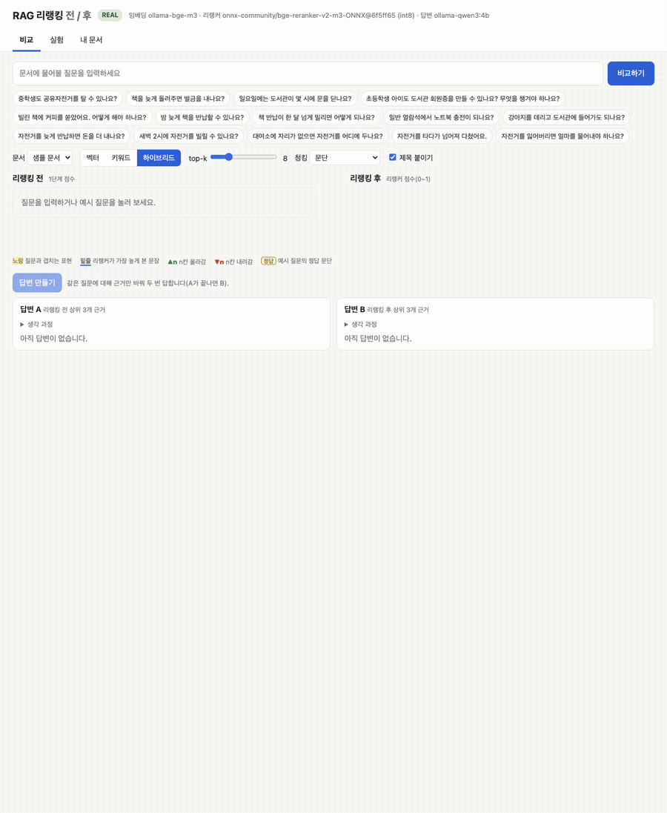
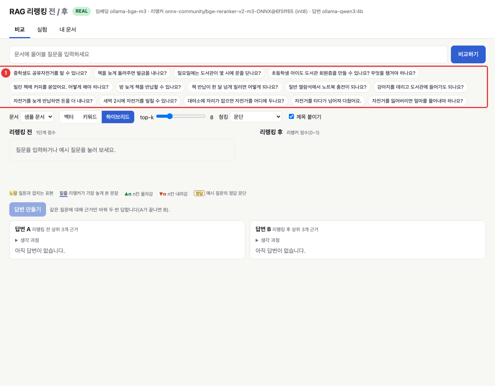
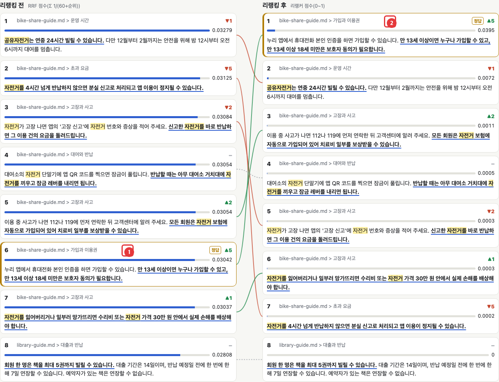
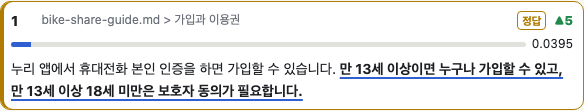
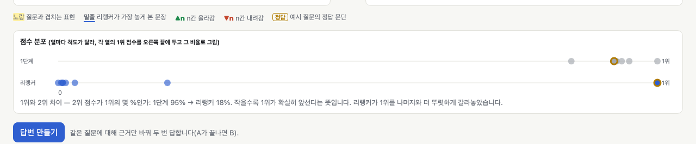
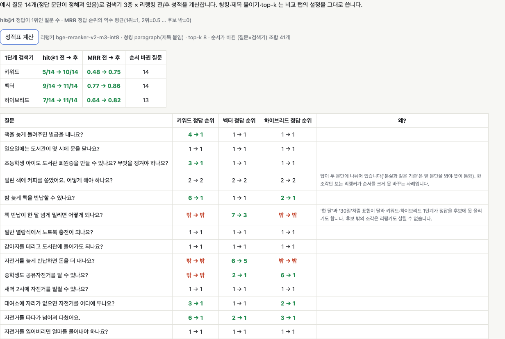
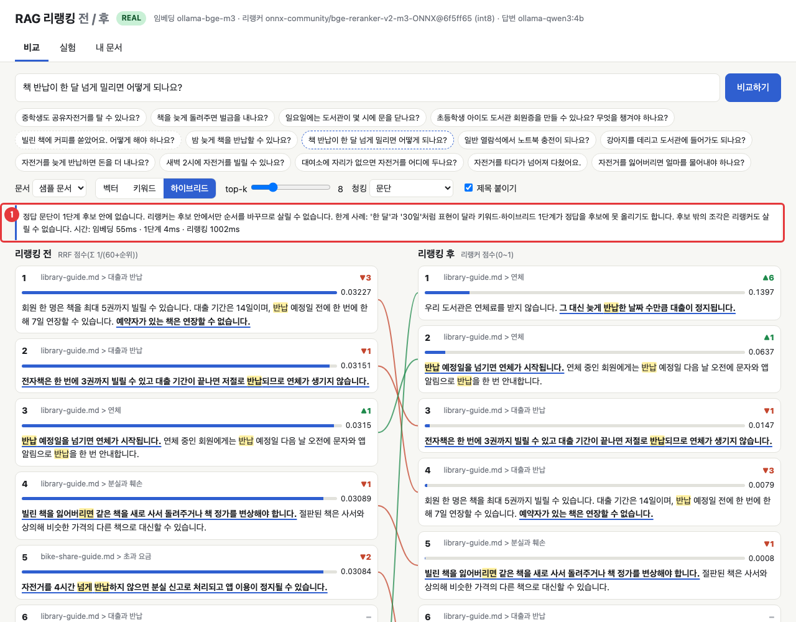
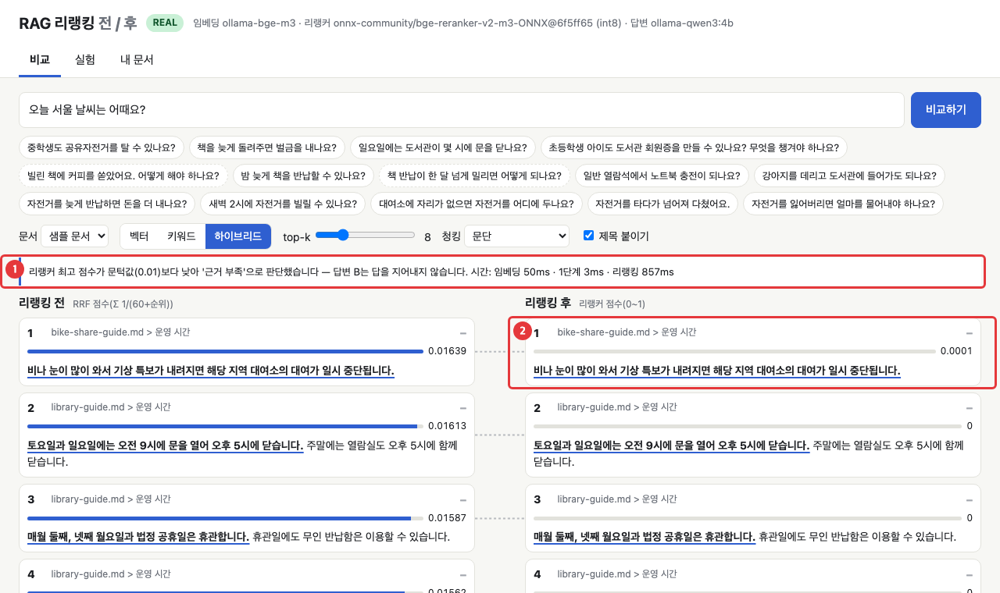
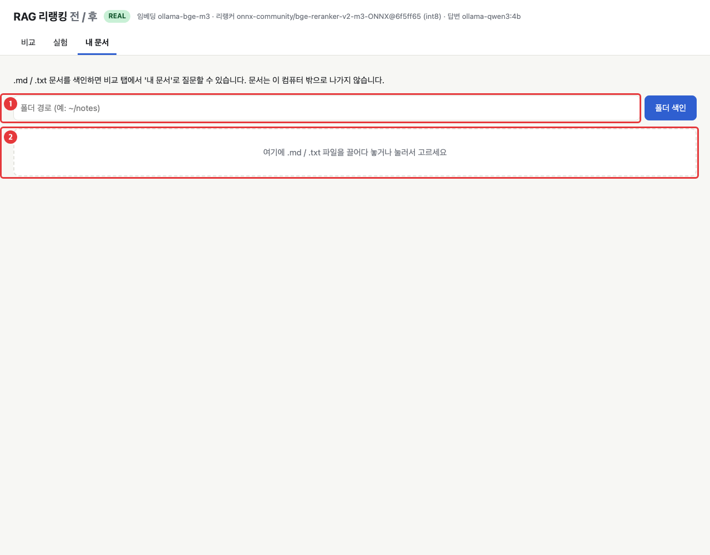
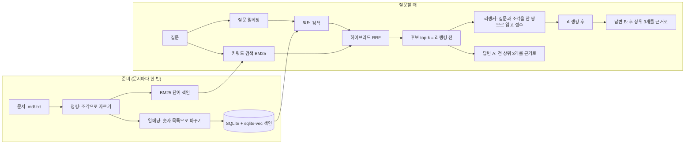

# RAG 리랭킹 전/후 비교 — 문서 검색이 어떻게 답변을 바꾸는지 눈으로 보기

[English](README.md) | **한국어**


<sub>예시 질문을 누르면 왼쪽(리랭킹 전)에서 6위였던 정답 문단이 오른쪽(리랭킹 후)에서 1위로 올라갑니다. 초록 선은 올라간 카드, 빨간 선은 내려간 카드입니다. (실제 모드, 맥북 M3 16GB에서 촬영)</sub>

## 한 줄 요약

문서를 조각으로 잘라 검색하고, 찾은 조각을 근거로 답하는 **RAG**를 직접 돌려 보면서, **리랭킹(다시 줄 세우기)** 한 단계가 순위와 답변을 어떻게 바꾸는지 같은 화면에서 비교합니다.

**이런 분께:**
- "RAG가 뭔지는 들어 봤는데 속에서 무슨 일이 일어나는지 모르겠다"는 분
- 검색 결과가 어딘가 엉뚱할 때 무엇을 손봐야 하는지 감을 잡고 싶은 분
- 내 문서(`.md`, `.txt`)로 직접 실험해 보고 싶은 분

## 왜 알아야 하나요?

도서관에서 "중학생도 공유자전거를 탈 수 있나요?"를 사서에게 물었다고 해 봅시다. 사서는 서가에서 관련 있어 보이는 책 20권을 빠르게 뽑아 옵니다. 하지만 서두르다 보니 '공유자전거'라는 말이 많이 나온 이용 시간 안내가 맨 위에 놓이고, 정작 "만 13세 이상이면 누구나"라고 적힌 가입 안내는 6번째에 끼어 있습니다.

그래서 사서가 뽑아 온 20권을 질문과 나란히 펼쳐 놓고 **한 권씩 꼼꼼히 읽으며 다시 줄을 세웁니다.** 이 두 번째 단계가 리랭킹입니다. 첫 단계는 빠르지만 거칠고, 두 번째 단계는 느리지만 정확합니다. AI 모델이 답을 쓸 때는 맨 위 몇 개만 근거로 읽으므로, 정답이 6위에 있는지 1위에 있는지에 따라 답이 "모르겠습니다"가 되기도 하고 정확한 답이 되기도 합니다. 이 데모는 바로 그 차이를 보여 줍니다.

## 30초 만에 실행하기

준비물: `git`과 [uv](https://docs.astral.sh/uv/)(파이썬 실행·패키지 관리 도구). uv가 Python 3.14를 알아서 내려받으므로 Python을 따로 설치하지 않아도 됩니다. 실제 모델로 돌릴 때만 [Ollama](https://ollama.com)가 필요합니다. API 키는 필요 없습니다.

```bash
# uv 설치(한 번만). macOS·Linux:
curl -LsSf https://astral.sh/uv/install.sh | sh
# 또는 macOS: brew install uv / Windows(PowerShell): winget install --id=astral-sh.uv -e
# git이 없다면 macOS: xcode-select --install / Ubuntu·Debian: sudo apt install git
```

```bash
git clone https://github.com/LeeGyeongPil/ai-lab-rag-rerank.git
cd ai-lab-rag-rerank
uv run rag-rerank --mock
```

터미널에 `화면: http://127.0.0.1:8765` 줄이 찍히고 브라우저가 열립니다. 화면 없는 서버·SSH·컨테이너처럼 브라우저가 열리지 않는 곳이면 그 주소를 직접 여세요. 브라우저를 자동으로 열지 않으려면 `uv run rag-rerank --mock --no-browser`(또는 `RAG_NO_BROWSER=1`)로 실행합니다. 도커 안에서 돌린다면 [자주 겪는 문제](#자주-겪는-문제)를 보세요.

`--mock`은 **연습 모드**입니다. 네트워크도 모델도 쓰지 않고 가짜 임베딩·가짜 리랭커·가짜 답변(근거 문장을 그대로 옮김)으로 같은 결과를 항상 똑같이 만들어 줍니다. 가짜 모델은 샘플 문서에 맞춘 작은 '뜻 사전'(예: `중학생` ↔ `만 13세`)으로 같은 뜻 다른 표현을 흉내 내므로 **"리랭킹으로 정답이 올라오는 장면"은 mock에서도 그대로 보입니다.** 다만 점수·순위 숫자와 답변 문장은 실제 모드와 다르고 검색 품질을 뜻하지 않습니다(화면에 `MOCK` 배지가 붙습니다). mock에서 무엇이 나오는지는 [연습(mock) 모드로 따라 하기](#연습mock-모드로-따라-하기)에 실제 출력을 붙여 두었습니다.

실제 모델로 돌려 보려면 Ollama를 설치한 뒤:

```bash
ollama pull bge-m3      # 문서와 질문을 숫자로 바꾸는 임베딩 모델 (약 1.2GB)
ollama pull qwen3:4b    # 답변을 쓰는 모델 (약 2.5GB)
uv run rag-rerank       # Ollama와 모델이 보이면 자동으로 실제 모드
```

처음 비교를 할 때 리랭커 모델(약 588MB)이 한 번 내려받아집니다. 의존성 설치와 리랭커 다운로드를 포함해 빈 상태에서 첫 비교 결과가 나오기까지 26초가 걸렸습니다(`scripts/first_run.sh`로 측정, 빠른 네트워크 기준, uv 패키지 캐시가 있는 상태). **이 문서의 스크린샷과 `[REAL]`로 시작하는 출력은 모두 실제 모드 결과입니다.** mock 모드 출력은 [아래 절](#연습mock-모드로-따라-하기)에 따로 있습니다.


<sub>첫 화면. 위쪽 초록 배지는 현재 모드(REAL 또는 MOCK), 1번은 눌러 볼 수 있는 예시 질문 14개, 그 아래는 1단계 검색기(벡터·키워드·하이브리드) 선택입니다. 점선 테두리 버튼은 리랭킹이 힘들어하는 '한계 사례'입니다.</sub>

터미널만 쓰고 싶다면 같은 비교를 글자로도 볼 수 있습니다. 아래는 **실제 모드** 출력입니다(mock에서는 맨 끝에 `--mock`을 붙이고, 결과는 다음 절에 있습니다).

```bash
uv run rag-rerank ask "책을 늦게 돌려주면 벌금을 내나요?" --retriever keyword
```

```text
[REAL] Ollama와 모델이 준비되어 실제 모드로 실행합니다.
질문: 책을 늦게 돌려주면 벌금을 내나요?
검색기: keyword · top-k 8 · 청킹 paragraph(제목 붙임) · 색인 33개 청크

리랭킹 전  [BM25 점수(상한 없음)]
  순위  점수      이동  출처 / 내용
    1   8.1094    ▼1    library-guide.md > 분실과 훼손 | 빌린 책을 잃어버리면 같은 책을 새로 사서 돌려주거나 책 정가를 변…
    2   7.7518    ▼2    bike-share-guide.md > 안전 | 헬멧은 대여소 옆 헬멧 보관함에서 무료로 빌릴 수 있습니다. 쓴 헬…
    3   5.2221    ▼2    bike-share-guide.md > 고장과 사고 | 자전거가 고장 나면 앱의 '고장 신고'에 자전거 번호와 증상을 적어…
    4   3.5029    ▲3    library-guide.md > 연체 | 우리 도서관은 연체료를 받지 않습니다. 그 대신 늦게 반납한 날짜 …
    ...

리랭킹 후  [리랭커 점수(0~1)]
  순위  점수      이동  전순위  출처 / 내용
    1   0.0308    ▲3       4    library-guide.md > 연체 | 우리 도서관은 연체료를 받지 않습니다. 그 대신 늦게 반납한 날짜 …
    2   0.0023    ▼1       1    library-guide.md > 분실과 훼손 | 빌린 책을 잃어버리면 같은 책을 새로 사서 돌려주거나 책 정가를 변…
    ...
1위와 2위 차이: 2위 점수가 1위의 96%(1단계) → 7%(리랭커) — 작을수록 1위가 확실히 앞섬

시간(ms): 임베딩 0 · 1단계 0 · 리랭킹 747
```

(`...`는 지면 때문에 줄인 부분입니다. 키워드 검색 1단계에서 4위였던 정답 문단("연체료를 받지 않습니다")이 리랭킹 뒤 1위가 됩니다.)

## 연습(mock) 모드로 따라 하기

Ollama가 없어도 `--mock`만으로 아래를 그대로 재현할 수 있습니다. 출력은 이 저장소에서 실제로 실행해 붙인 것이고, mock은 결정적이라 어느 컴퓨터에서든 같은 숫자가 나옵니다.

**1) 화면 띄우기**

```bash
uv run rag-rerank --mock --no-browser
```

```text
[MOCK] --mock 플래그(또는 RAG_MODE=mock)로 mock 모드를 켰습니다.
화면: http://127.0.0.1:8765  (끝내려면 Ctrl+C)
```

브라우저에서 이 주소를 열고 첫 번째 예시 질문 `중학생도 공유자전거를 탈 수 있나요?`를 누르세요. 정답 문단(`만 13세 이상이면 누구나 …`)이 왼쪽(리랭킹 전) 6위에서 오른쪽(리랭킹 후) 1위로 올라가고 `▲5` 배지가 붙습니다. 이동은 실제 모드 스크린샷과 같고, 리랭커 점수는 0.4292로 실제 모드(0.0395)와 다릅니다. `답변 만들기`를 누르면 답변 A와 B가 곧바로 나옵니다.

**2) 터미널에서 같은 비교 보기**

```bash
uv run rag-rerank ask "중학생도 공유자전거를 탈 수 있나요?" --mock
```

```text
[MOCK] --mock 플래그(또는 RAG_MODE=mock)로 mock 모드를 켰습니다.
질문: 중학생도 공유자전거를 탈 수 있나요?
검색기: hybrid · top-k 8 · 청킹 paragraph(제목 붙임) · 색인 33개 청크

리랭킹 전  [RRF 점수(Σ 1/(60+순위))]
  순위  점수      이동  출처 / 내용
    1   0.032     ▼3    bike-share-guide.md > 고장과 사고 | 자전거를 잃어버리거나 일부러 망가뜨리면 수리비 또는 자전거 가격 3…
    2   0.03151   ▼3    bike-share-guide.md > 고장과 사고 | 자전거가 고장 나면 앱의 '고장 신고'에 자전거 번호와 증상을 적어…
    3   0.03125   –     bike-share-guide.md > 초과 요금 | 자전거를 4시간 넘게 반납하지 않으면 분실 신고로 처리되고 앱 이용…
    4   0.03058   ▼3    library-guide.md > 회원증 | 회원증을 잃어버리면 재발급 수수료 없이 다시 만들 수 있습니다. 모…
    5   0.02955   ▲3    bike-share-guide.md > 운영 시간 | 공유자전거는 연중 24시간 빌릴 수 있습니다. 다만 12월부터 2월…
    6   0.02944   ▲5    bike-share-guide.md > 가입과 이용권 | 누리 앱에서 휴대전화 본인 인증을 하면 가입할 수 있습니다. 만 1…
    7   0.02938   ▼1    library-guide.md > 분실과 훼손 | 빌린 책을 잃어버리면 같은 책을 새로 사서 돌려주거나 책 정가를 변…
    8   0.02927   ▲2    bike-share-guide.md > 대여와 반납 | 대여소의 자전거 단말기에 앱 QR 코드를 찍으면 잠금이 풀립니다. …

리랭킹 후  [리랭커 점수(0~1)]
  순위  점수      이동  전순위  출처 / 내용
    1   0.4292    ▲5       6    bike-share-guide.md > 가입과 이용권 | 누리 앱에서 휴대전화 본인 인증을 하면 가입할 수 있습니다. 만 1…
    2   0.3586    ▲3       5    bike-share-guide.md > 운영 시간 | 공유자전거는 연중 24시간 빌릴 수 있습니다. 다만 12월부터 2월…
    3   0.2008    –        3    bike-share-guide.md > 초과 요금 | 자전거를 4시간 넘게 반납하지 않으면 분실 신고로 처리되고 앱 이용…
    4   0.1671    ▼3       1    bike-share-guide.md > 고장과 사고 | 자전거를 잃어버리거나 일부러 망가뜨리면 수리비 또는 자전거 가격 3…
    5   0.1671    ▼3       2    bike-share-guide.md > 고장과 사고 | 자전거가 고장 나면 앱의 '고장 신고'에 자전거 번호와 증상을 적어…
    6   0.1671    ▲2       8    bike-share-guide.md > 대여와 반납 | 대여소의 자전거 단말기에 앱 QR 코드를 찍으면 잠금이 풀립니다. …
    7   0.0708    ▼3       4    library-guide.md > 회원증 | 회원증을 잃어버리면 재발급 수수료 없이 다시 만들 수 있습니다. 모…
    8   0.0708    ▼1       7    library-guide.md > 분실과 훼손 | 빌린 책을 잃어버리면 같은 책을 새로 사서 돌려주거나 책 정가를 변…

1위와 2위 차이: 2위 점수가 1위의 98%(1단계) → 84%(리랭커) — 작을수록 1위가 확실히 앞섬

시간(ms): 임베딩 0 · 1단계 0 · 리랭킹 0

답변 A (리랭킹 전 상위 3개 근거): 근거에 따르면 자전거를 잃어버리거나 일부러 망가뜨리면 수리비 또는 자전거 가격 30만 원 안에서 실제 손해를 배상해야 합니다. [1]
  인용: [1]=bike-share-guide#11

답변 B (리랭킹 후 상위 3개 근거): 근거에 따르면 만 13세 이상이면 누구나 가입할 수 있고, 만 13세 이상 18세 미만은 보호자 동의가 필요합니다. [1]
  인용: [1]=bike-share-guide#0
```

읽는 법:
- 정답 문단이 1단계 6위에서 리랭킹 뒤 1위(`▲5`)로 올라옵니다. 이것이 이 데모의 핵심 장면입니다.
- 답변 A는 리랭킹 전 1위인 엉뚱한 문단(자전거 배상)을 옮기고, 답변 B는 정답 문단의 `만 13세 이상` 문장을 `[1]`로 인용합니다. mock 답변은 모델이 쓰는 것이 아니라 1번 근거에서 질문과 가장 많이 겹치는 문장을 그대로 옮긴 것이라, 실제 모드처럼 "근거를 찾지 못했습니다"라고 하지 않고 틀린 근거를 그대로 옮깁니다. **근거가 틀리면 답도 틀린다**는 점은 같습니다.
- "1위와 2위 차이"는 98% → 84%로 실제 모드(95% → 18%)보다 조금만 줄어듭니다. 가짜 리랭커 점수는 질문 표현이 얼마나 들어 있는지만 보기 때문에 1위를 크게 떼어 놓지 못합니다.
- mock에서는 시간이 늘 0으로 찍힙니다(같은 입력 → 같은 출력을 지키려고).

앞 절의 키워드 검색 예시(`책을 늦게 돌려주면 벌금을 내나요?` `--retriever keyword --mock`)도 mock에서 정답이 4위 → 1위로 올라오고, 답변 B는 "근거에 따르면 우리 도서관은 연체료를 받지 않습니다. [1]"입니다(점수는 실제 모드와 다릅니다).

**3) 성적표**

```bash
uv run rag-rerank eval --mock
```

```text
[MOCK] --mock 플래그(또는 RAG_MODE=mock)로 mock 모드를 켰습니다.
성적표 — 질문 14개, top-k 8, 리랭커 mock-overlap
  검색기    hit@1 전→후    MRR 전→후        순서 바뀐 질문
  keyword    5/14 →  8/14   0.48 → 0.64      9
  vector     5/14 →  8/14   0.51 → 0.68      14
  hybrid     4/14 →  9/14   0.50 → 0.72      13

순서가 바뀐 (질문 × 검색기) 조합: 36
```

숫자는 실제 모드([5단계](#5단계-성적표로-운이-아니었는지-확인하기))와 다릅니다. mock의 뜻 사전은 예시 질문에서 리랭킹 장면이 보이도록 **일부러 만든 것**이라, 이 표는 리랭킹이 효과가 있다는 증거가 아니라 화면 흐름을 익히는 연습용입니다. 리랭킹이 실제로 얼마나 도움이 되는지는 5단계의 실제 모드 성적표(하이브리드 hit@1 7/14 → 11/14)로 확인하세요. mock으로 띄운 웹 화면의 **실험** 탭도 위의 연습용 숫자를 보여 줍니다.

**4) 한계 사례와 근거 부족**

- `책 반납이 한 달 넘게 밀리면 어떻게 되나요?`는 mock에서도 정답이 1단계 후보 8개 안에 없어 "정답 문단이 1단계 후보 안에 없습니다" 안내가 뜹니다([6단계](#6단계-리랭커가-못-고치는-경우-보기)와 같은 장면).
- `오늘 서울 날씨는 어때요?`는 mock에서도 '근거 부족'이 됩니다. mock 리랭커는 가짜 점수에 맞춘 **고정 문턱값 0.1**을 씁니다(실제 모드의 0.01과 다르고, `RAG_MIN_RERANK_SCORE`의 영향을 받지 않습니다).

```bash
uv run rag-rerank ask "오늘 서울 날씨는 어때요?" --mock
```

```text
...
※ 리랭커 최고 점수가 문턱값보다 낮아 '근거 부족'으로 판단했습니다.

시간(ms): 임베딩 0 · 1단계 0 · 리랭킹 0

답변 A (리랭킹 전 상위 3개 근거): 근거에 따르면 시각장애인 안내견을 제외한 반려동물은 도서관 건물 안에 들어올 수 없습니다. [1]
  인용: [1]=library-guide#18

답변 B (리랭킹 후 상위 3개 근거): 문서에서 근거를 찾지 못했습니다.
  인용: 없음
```

(`...`는 지면 때문에 줄인 부분입니다. 근거 부족이면 답변 B만 모델을 부르지 않고 "문서에서 근거를 찾지 못했습니다."로 답합니다. 답변 A는 비교를 위해 리랭킹 전 근거로 그대로 답하므로, 관련 없는 문장을 옮깁니다.)

## 단계별로 따라 하기

> 이 절의 스크린샷·숫자·답변은 모두 **실제 모드**(Ollama + 리랭커 모델) 결과입니다. `--mock`으로 열었다면 화면 구조와 정답이 움직이는 방향은 같지만 점수·순위 숫자와 답변 문장은 다릅니다. mock 결과는 [바로 위 절](#연습mock-모드로-따라-하기)과 비교하세요.

### 1단계. 예시 질문을 눌러 두 목록을 나란히 보기

첫 번째 예시 질문 `중학생도 공유자전거를 탈 수 있나요?`를 누르세요. 검색기는 기본값인 **하이브리드**, 가져올 후보 수(top-k)는 8입니다. 1~2초 안에 왼쪽(리랭킹 전)과 오른쪽(리랭킹 후) 목록이 나타나고 카드가 제자리를 찾아 움직입니다.


<sub>1번 표시가 붙은 카드는 리랭킹 전 6위, 2번 표시가 붙은 카드는 같은 문단이 리랭킹 후 1위로 올라간 모습입니다. 카드 오른쪽 위의 `▲5`는 "5칸 올라갔다"는 뜻의 배지이고, 가운데 선이 같은 카드를 이어 줍니다.</sub>

읽는 법:
- 왼쪽은 1단계 검색이 매긴 순서, 오른쪽은 리랭커가 다시 매긴 순서입니다.
- `▲5`는 5칸 올라감, `▼1`은 1칸 내려감, `–`는 그대로입니다.
- 금색 테두리와 `정답` 표시는 예시 질문에 한해, 미리 정해 둔 정답 문단에 붙습니다. 내 문서에는 정답을 모르므로 표시되지 않습니다.
- **두 열의 점수는 척도가 다릅니다.** 왼쪽은 하이브리드의 RRF 점수(0.028~0.033 사이에 몰려 있음), 오른쪽은 리랭커 점수(0~1)입니다. 막대 길이를 열 사이에서 비교하지 마세요.

### 2단계. 근거 문장 확인하기

각 카드 안에서 **노란 칠**은 질문과 글자가 겹치는 표현이고, **밑줄 + 굵은 글씨**는 리랭커가 "이 문장이 질문에 가장 가깝다"고 고른 문장입니다.


<sub>리랭킹 후 1위 카드. 질문에는 '공유자전거'도 '탈 수'도 나오지만, 리랭커는 글자가 겹치지 않는 "만 13세 이상이면 누구나 가입할 수 있고"를 근거 문장으로 골랐습니다. 리랭커 점수는 0.0395입니다.</sub>

리랭커 점수가 0.0395처럼 작아도 1위일 수 있습니다. 이 점수는 "정답일 확률"이 아니라 후보끼리 비교하는 상대 점수입니다. 순서를 믿으시고 절댓값은 크게 신경 쓰지 않으셔도 됩니다.

### 3단계. 1위가 얼마나 뚜렷한지 보기

비교 화면 아래에는 점수 분포 그림이 있습니다. 위 줄은 1단계 점수, 아래 줄은 리랭커 점수이고 점 하나가 후보 하나입니다. 두 줄은 점수의 뜻(척도)이 달라서, **각 줄의 1위 점수를 오른쪽 끝(`1위`)에 두고 나머지를 그 비율로** 그렸습니다. 금색 테두리 점이 정답 문단입니다.


<sub>1단계(하이브리드) 줄에서는 8개 점이 1위 가까이에 몰려 있어 1위와 나머지가 거의 구분되지 않습니다. 리랭커 줄에서는 1위(금색 테두리의 정답)만 오른쪽 끝에 있고 나머지는 멀리 떨어져 있습니다. 그림 아래 문장은 "1위와 2위 차이 — 2위 점수가 1위의 몇 %인가: 1단계 95% → 리랭커 18%"라고 요약합니다.</sub>

읽는 법: **"2위 점수가 1위의 몇 %인가"가 작을수록 1위가 확실히 앞선 것**입니다. 1단계에서는 2위가 1위의 95%라서 사실상 동점에 가깝고, 리랭커를 거치면 18%로 줄어 정답이 나머지와 뚜렷이 갈립니다. 비슷한 점수끼리는 순서가 사소한 차이로 뒤바뀌기 쉬우므로, 1단계 점수만으로는 1위를 믿기 어렵다는 것이 리랭킹이 필요한 이유입니다. 터미널 `ask` 결과에도 같은 내용이 "1위와 2위 차이" 줄로 나옵니다.

### 4단계. 답변 A와 B 비교하기

`답변 만들기`를 누르면 **같은 질문에 근거만 바꿔서** 모델이 두 번 답합니다. 답변 A는 리랭킹 전 상위 3개, 답변 B는 리랭킹 후 상위 3개를 근거로 읽습니다. A가 끝나야 B가 시작됩니다.

![답변 A는 '문서에서 근거를 찾지 못했습니다', 답변 B는 인용 [1]이 붙은 정확한 답](docs/images/05-answers.png)
<sub>답변 A(리랭킹 전 근거)는 "문서에서 근거를 찾지 못했습니다.", 답변 B(리랭킹 후 근거)는 "중학생이 만 13세 이상이면 가입할 수 있으나, 만 13세 이상 18세 미만은 보호자 동의가 필요합니다. [1]".</sub>

정답 문단이 상위 3개 밖(6위)에 있던 A는 근거를 못 찾았다고 답하고, 상위 1위가 된 B는 정확하게 답하며 `[1]`처럼 **어느 근거에서 나온 말인지** 번호를 붙입니다. `생각 239토큰`은 이 모델이 답하기 전에 속으로 생각한 분량입니다(내용은 접어 둡니다).

답변은 느립니다. 이 맥북(M3 16GB)에서 A와 B를 합쳐 약 4분이 걸렸습니다(Ollama를 다른 작업과 함께 쓰던 때의 값이며, 답 하나에 보통 수십 초~2분이 걸립니다). 비교 화면은 먼저 뜨고, 답변은 버튼을 눌러야 시작되며 `중지` 버튼으로 끊을 수 있습니다. 더 빠른 답변이 필요하면 [직접 바꿔 보기](#직접-바꿔-보기)의 4번을 보세요.

### 5단계. 성적표로 "운이 아니었는지" 확인하기

한 질문에서 잘된 것이 우연일 수 있으니, **실험** 탭에서 14개 예시 질문 모두를 3가지 검색기로 돌려 리랭킹 전/후를 채점합니다(약 14초).


<sub>위 표는 검색기별 요약, 아래 표는 질문별로 정답 문단의 순위가 어떻게 바뀌었는지입니다. 초록은 개선, 빨강 `밖 → 밖`은 1단계가 후보에도 못 올린 경우입니다.</sub>

- **hit@1**: 정답이 1위인 질문이 몇 개인가(14개 중).
- **MRR**: 정답 순위의 역수를 평균한 값. 1위면 1, 2위면 0.5, 후보 밖이면 0입니다.
- **순서 바뀐 질문**: 리랭킹 뒤 후보 8개의 순서가 한 칸이라도 달라진 질문 수(14개 중). 정답이 올라갔는지와는 상관없이 "리랭커가 순서를 손댔는가"만 셉니다. 14에 가까울수록 리랭커가 1단계와 다른 기준으로 읽는다는 뜻이고, 그 변화가 좋은 쪽이었는지는 hit@1·MRR로 봅니다.

| 1단계 검색기 | hit@1 전 → 후 | MRR 전 → 후 | 순서 바뀐 질문 |
|---|---|---|---|
| 키워드 | 5/14 → 10/14 | 0.48 → 0.75 | 14 |
| 벡터 | 9/14 → 11/14 | 0.77 → 0.86 | 14 |
| 하이브리드 | 7/14 → 11/14 | 0.64 → 0.82 | 13 |

(실제 모드, top-k 8, 문단 청킹 + 제목 붙이기, 14개 질문 기준. Ollama 모델 버전이 바뀌면 숫자가 달라질 수 있습니다.)

여기서 알 수 있는 것 두 가지가 있습니다. 첫째, 어떤 검색기로 시작해도 리랭킹을 거치면 좋아집니다. 둘째, **하이브리드가 항상 이기는 것은 아닙니다.** 리랭킹 전에는 하이브리드(7/14)가 벡터 단독(9/14)보다 낮았습니다. 서로 다른 두 검색기를 섞는다고 저절로 좋아지지는 않으며, 샘플 문서가 작아서 생긴 결과일 수도 있습니다.

### 6단계. 리랭커가 못 고치는 경우 보기

점선 테두리 예시 질문은 일부러 어렵게 만든 한계 사례입니다. `책 반납이 한 달 넘게 밀리면 어떻게 되나요?`를 눌러 보세요. 문서에는 "30일"이라고 쓰여 있어서 '한 달'과 글자가 안 맞습니다.


<sub>1번 안내문은 "정답 문단이 1단계 후보 안에 없습니다. 리랭커는 후보 안에서만 순서를 바꾸므로 살릴 수 없습니다."라고 알려 줍니다. 후보 8개 안에 정답("장기 연체가 30일을 …")이 없어서, 순서가 아무리 바뀌어도 정답이 올라오지 않습니다.</sub>

**리랭커는 후보 안에서만 순서를 바꿉니다.** 1단계가 정답을 놓치면 리랭킹으로 되살릴 수 없습니다. 이럴 때는 top-k를 늘리거나, 검색기를 바꾸거나, 문서를 자르는 방식을 바꿔 보세요.

### 7단계. 문서에 답이 없으면 "근거 부족"

문서에 없는 질문(`오늘 서울 날씨는 어때요?`)을 해 보세요.


<sub>1번 안내문은 "리랭커 최고 점수가 문턱값(0.01)보다 낮아 '근거 부족'으로 판단했습니다 — 답변 B는 답을 지어내지 않습니다." 2번 카드는 1위 후보인데도 점수가 0.0001에 그칩니다.</sub>

리랭커 최고 점수가 문턱값보다 낮으면 '근거 부족'으로 판단하고, **답변 B는 모델을 부르지 않고** "문서에서 근거를 찾지 못했습니다."라고 답합니다. 관련 없는 근거를 억지로 끼워 맞춘 답을 막는 안전장치입니다. 답변 A는 비교를 위해 그대로 리랭킹 전 상위 3개를 근거로 모델에 묻습니다(모델이 스스로 근거가 없다고 답할 수도, 엉뚱한 근거로 답할 수도 있습니다). 문턱값은 실제 모드에서 기본 0.01이고 `RAG_MIN_RERANK_SCORE`로 바꿀 수 있습니다. mock 모드는 가짜 점수에 맞춘 고정값 0.1을 씁니다. 리랭커 점수는 "관련 있는가"를 후보끼리 상대 비교하는 데도 쓰이지만, 이렇게 "아예 관련 없다"를 잡아내는 데도 쓸 수 있습니다.

### 8단계. 내 문서로 해 보기

**내 문서** 탭에서 폴더 경로를 적거나 파일을 끌어다 놓으면 그 문서가 색인됩니다. 색인이 끝나면 자동으로 비교 탭으로 돌아가 "내 문서"가 선택됩니다.


<sub>1번은 폴더 경로 입력(예: `~/notes`), 2번은 `.md`/`.txt` 파일을 끌어다 놓는 곳입니다. 문서는 이 컴퓨터 밖으로 나가지 않습니다.</sub>

터미널에서는 `uv run rag-rerank index ~/notes --show 5`로 문서가 어떻게 잘리는지 먼저 볼 수 있고, `uv run rag-rerank ask "회의는 언제 하나요?" --docs ~/notes`처럼 `--docs`에 폴더를 주면 샘플 대신 그 문서에서 찾아 전/후를 비교합니다(`--docs`가 없으면 샘플 문서에서 찾습니다). 파일은 최대 200개, 파일당 1MB까지 읽습니다. 색인 파일(`.cache/index`)은 최대 16개까지 보관합니다.

폴더가 없거나 `.md`/`.txt` 문서가 하나도 없으면 오류 글(traceback) 대신, 모드 안내 줄 다음에 `폴더가 아닙니다: <경로>` 또는 `.md 또는 .txt 문서를 찾지 못했습니다.` 한 줄을 stderr에 찍고 종료 코드 1로 끝납니다(v0.1.2).

## 어떻게 동작하나요?



1. **청킹(chunking)**: 문서 전체를 한 번에 모델에 넣을 수 없고, 전체를 하나의 숫자로 요약하면 세부가 뭉개집니다. 그래서 문서를 문단 같은 작은 조각(청크)으로 자릅니다. 이 데모는 문단 / 재귀 분할(200자) / 제목 단위 중에서 고를 수 있고, 조각 앞에 `[문서 > 절 제목]`을 붙여 맥락을 보강하는 옵션이 있습니다.
2. **임베딩(embedding)**: 글을 뜻이 비슷하면 가까워지는 숫자 목록(벡터)으로 바꿉니다. "반납"과 "돌려주기"는 글자가 다르지만 숫자는 가깝습니다. 이 데모는 `bge-m3`를 씁니다.
3. **벡터 검색**: 질문도 같은 방식으로 숫자로 바꾸고, 숫자가 가장 가까운(코사인 유사도가 높은) 조각을 찾습니다. 뜻으로 찾기 때문에 표현이 달라도 찾지만, 고유한 이름·숫자는 놓치기도 합니다.
4. **키워드 검색(BM25)**: 질문과 같은 글자가 많이 겹치는 조각을 찾는 고전적 방법입니다. 한국어는 "반납하면/반납한/반납을"처럼 조사가 붙어서 띄어쓰기 단위로는 잘 안 맞기 때문에, 이 데모는 **글자를 2글자씩 겹쳐 자른 토큰**(예: `반납하면` → `반납`·`납하`·`하면`)으로 BM25를 계산합니다. 드문 토큰이 많이 겹칠수록, 짧은 조각일수록 점수가 높습니다. (SQLite의 `trigram`은 3글자 단위라 `연체`처럼 2글자 검색어를 아예 못 찾아서 직접 구현했고, 테스트로 그 함정을 확인합니다.)
5. **하이브리드 = RRF**: 벡터 점수(−1~1)와 BM25 점수(상한 없음)는 척도가 달라 더할 수 없습니다. 그래서 **점수는 버리고 순위만** 씁니다. 각 검색기에서 20개씩 받아 조각마다 `1 / (60 + 순위)`를 모두 더합니다(60은 RRF 논문의 관례값). 양쪽에서 모두 상위권이면 점수가 높아집니다. 점수 차이가 작은 것이 정상입니다.
6. **리랭킹(cross-encoder)**: 1~5는 질문과 조각을 **따로** 숫자로 만들어 비교합니다(빠르지만 거침). 리랭커는 질문과 조각을 **한 쌍으로 붙여서 함께 읽고** 0~1 점수를 냅니다(느리지만 정확). 후보 8~20개만 읽기 때문에 부담이 적습니다. 이 데모는 `bge-reranker-v2-m3`를 ONNX 형식(int8)으로 CPU에서 돌려 순서를 다시 매깁니다. 같은 모델로 문장마다 점수를 매겨 밑줄 칠 근거 문장도 고릅니다.
7. **근거 기반 답변(grounded answer)**: 모델에게 "주어진 근거만 쓰고, 쓴 근거 번호를 `[1]`처럼 붙이고, 근거에 답이 없으면 없다고 하라"고 시킵니다. 그래서 답이 근거에서 나왔는지 확인할 수 있습니다.

## 코드 둘러보기

처음 읽는다면 `pipeline.py` → `retrieve.py` → `reranker.py` 순서를 추천합니다.

| 파일 | 하는 일 |
|---|---|
| [`src/rag_rerank/pipeline.py`](src/rag_rerank/pipeline.py) | 같은 후보를 "전/후"로 두 번 줄 세워 한 결과에 담는 `compare()` |
| [`src/rag_rerank/retrieve.py`](src/rag_rerank/retrieve.py) | 벡터 / 키워드 / 하이브리드(RRF) 1단계 검색 |
| [`src/rag_rerank/reranker.py`](src/rag_rerank/reranker.py) | 리랭커 모델 내려받기와 점수 계산(ONNX, CPU) |
| [`src/rag_rerank/bm25.py`](src/rag_rerank/bm25.py) | 한글 2글자 토큰 BM25 |
| [`src/rag_rerank/chunking.py`](src/rag_rerank/chunking.py) | 문단 / 재귀 / 제목 단위로 자르기 |
| [`src/rag_rerank/generator.py`](src/rag_rerank/generator.py) | 근거 기반 답변 만들기(Ollama 또는 mock) |
| [`src/rag_rerank/mocklex.py`](src/rag_rerank/mocklex.py) | mock 모드 전용 '뜻 사전'(같은 뜻 다른 표현을 손으로 이어 둔 표) |
| [`src/rag_rerank/server.py`](src/rag_rerank/server.py), [`static/`](src/rag_rerank/static) | 웹 화면과 API |
| [`tests/`](tests) | 모의 모드 테스트(`uv run pytest -q -m 'not real'`) |

### 핵심 1. 같은 후보를 두 번 줄 세우기 (`pipeline.py`)

```python
order = sorted(range(len(hits)), key=lambda j: (-scores[j], j))  # 동점이면 1단계 순서 유지
for new_rank, j in enumerate(order, start=1):
    move = before[j]["rank"] - new_rank  # 양수 = 올라감
```

1단계가 가져온 후보(`hits`)를 리랭커 점수 순으로 다시 정렬할 뿐, 새 후보를 찾아오지는 않습니다. 그래서 리랭커는 후보 밖의 정답을 살릴 수 없습니다.

### 핵심 2. 순위만으로 합치는 RRF (`retrieve.py`)

```python
def rrf(rankings, k=60):
    fused = defaultdict(float)
    for ranking in rankings:
        for rank, item in enumerate(ranking, start=1):
            fused[item] += 1.0 / (k + rank)
    return sorted(fused.items(), key=lambda h: (-h[1], h[0]))
```

척도가 다른 두 점수를 더하는 대신 "몇 위였나"만 씁니다. `k`가 클수록 1위와 10위의 차이를 덜 크게 봅니다.

### 핵심 3. (질문, 조각)을 한 쌍으로 읽는 리랭커 (`reranker.py`)

```python
enc = self.tok.encode_batch([(query, t) for t in texts[i : i + batch]])  # (질문, 청크) 쌍
...
out += [round(float(1 / (1 + np.exp(-x))), 4) for x in logits]  # 시그모이드 → 0~1
```

질문과 조각을 한 입력으로 붙여 모델에 넣고, 나온 값을 시그모이드로 0~1로 바꿉니다. 이 계열 모델은 빈칸 채움용 글자(패딩)의 번호가 1이어야 점수가 맞습니다(0으로 두면 점수가 틀어집니다). 그래서 `pad_id=1`로 설정했습니다.

## 용어 사전

| 용어 | 뜻 |
|---|---|
| RAG | Retrieval-Augmented Generation. 질문과 관련된 문서 조각을 먼저 찾아 모델에게 근거로 주고 답하게 하는 방식 |
| 청킹 / 청크 | 문서를 작은 조각으로 자르는 일 / 그 조각 |
| 임베딩 | 글을 뜻이 비슷하면 가까워지는 숫자 목록으로 바꾼 것 |
| 벡터 검색 | 숫자 목록끼리의 거리로 뜻이 가까운 조각을 찾는 검색 |
| 코사인 유사도 | 두 숫자 목록이 가리키는 방향이 얼마나 같은지(−1~1). 클수록 비슷 |
| BM25 | 질문과 겹치는 단어가 많고 드문 단어일수록 높은 점수를 주는 키워드 검색 공식 |
| 하이브리드 검색 | 벡터 검색과 키워드 검색을 함께 쓰는 방식 |
| RRF | Reciprocal Rank Fusion. 여러 검색 결과를 점수 대신 순위로 합치는 방법 |
| top-k | 1단계에서 후보로 가져올 조각 수(k개) |
| 리랭킹 | 1단계 후보를 더 정교한 모델로 다시 줄 세우는 일 |
| 크로스 인코더 | 질문과 조각을 한 쌍으로 붙여 함께 읽고 점수를 내는 모델. 리랭커의 한 종류 |
| 근거 기반 답변 | 주어진 근거만으로 답하고 근거 번호를 붙이는 답변 |
| hit@1 | 정답 조각이 1위인 질문의 수(또는 비율) |
| MRR | 정답 순위의 역수를 평균한 값. 1위 1, 2위 0.5, 3위 0.33 … |
| ONNX / int8 | 모델을 다른 환경에서도 돌리기 쉽게 만든 파일 형식 / 숫자를 작게 줄여 작고 빠르게 만든 방식 |
| Ollama | 내 컴퓨터에서 AI 모델을 내려받아 돌려 주는 프로그램 |
| mock(연습) 모드 | 가짜 모델로 같은 결과를 항상 똑같이 만드는 모드. 작은 뜻 사전으로 리랭킹 장면을 흉내 내지만 숫자는 실제 모드와 다름 |

## 직접 바꿔 보기

1. **내 문서 넣기** — `내 문서` 탭에서 폴더를 색인 → 비교 탭에서 "내 문서" 선택 → 평소 찾던 질문을 던져 보세요. 정답 표시는 없지만 근거 문장 밑줄과 두 목록의 차이는 그대로 보입니다.
2. **top-k 줄이기** — 비교 화면의 `top-k` 슬라이더를 8에서 4로 → 정답이 후보 밖으로 밀려나면 비교 화면에 "정답 문단이 1단계 후보 안에 없습니다" 안내가 뜹니다. `실험` 탭에서 성적표를 다시 계산하면 `밖 → 밖`으로도 보입니다. 반대로 `책 반납이 한 달 넘게 …`에서 top-k를 20까지 올려 보세요. 후보가 늘면 정답이 후보에 들어올 수도 있습니다.
3. **제목 붙이기와 청킹 방식 바꾸기** — `제목 붙이기`를 끄고 `실험` 탭에서 성적표를 다시 계산해 보세요. 이 샘플에서는 제목을 붙였을 때 하이브리드 hit@1이 11/14, 끄면 10/14였습니다. `청킹`을 `재귀 분할(200자)`로 바꾸면 조각이 어떻게 달라지고 순위가 어떻게 변하는지도 볼 수 있습니다.
4. **빠른 답변 모델로 바꾸기** — `qwen3:4b`는 답하기 전에 수백~천여 토큰을 생각해서 느립니다. 생각 단계가 없는 모델을 받아 `RAG_CHAT_MODEL=<모델 이름> uv run rag-rerank`로 실행해 보세요(모델에 따라 답 형식이 달라질 수 있습니다).
5. **근거 부족 문턱값 조절**(실제 모드 전용, mock은 고정값 0.1) — `RAG_MIN_RERANK_SCORE=0.05 uv run rag-rerank`처럼 문턱값을 올리면 "근거 부족"이 더 자주 나오고, 낮추면 덜 나옵니다. 문서와 조금만 관련 있는 질문으로 시험해 보세요.
6. **검색기 바꿔 가며 같은 질문 비교하기** — `벡터` / `키워드` / `하이브리드`를 번갈아 눌러 보며 1단계 순위가 어떻게 다른지, 리랭킹 뒤에는 얼마나 비슷해지는지 보세요.

설정할 수 있는 환경변수는 [`.env.example`](.env.example)에 모두 있습니다.

## 자주 겪는 문제

| 증상 | 원인 | 해결 |
|---|---|---|
| 화면 위에 `MOCK` 배지가 붙고 숫자가 이 문서와 다릅니다 | `--mock`으로 실행했거나, Ollama가 꺼져 있거나 모델을 받지 않았습니다. mock 숫자는 [연습(mock) 모드로 따라 하기](#연습mock-모드로-따라-하기)에 있습니다 | `ollama pull bge-m3`, `ollama pull qwen3:4b` 후 `--mock` 없이 `uv run rag-rerank`를 다시 실행. 화면 위 안내와 `uv run rag-rerank doctor`가 빠진 항목을 알려 줍니다 |
| 포트가 이미 사용 중이라고 나옵니다 | 8765를 다른 프로그램이 쓰고 있습니다 | `uv run rag-rerank serve --port 8766` |
| 첫 비교가 오래 걸리고 진행 막대가 보입니다 | 리랭커 모델(약 588MB)을 처음 내려받는 중입니다 | 끝날 때까지 기다리세요. 실패하면 `다시 시도` 버튼(최대 3회)을 누르거나 `uv run rag-rerank doctor --download`로 미리 받으세요 |
| 답변이 나오기까지 몇 분이 걸립니다 | 생각 전용 모델이라 답하기 전에 많이 생각합니다 | 4단계 설명 참고. 120초를 넘기면 대신 근거 문장을 그대로 옮긴 답이 안내와 함께 나옵니다 |
| 실제 모드인데 `ReadTimeout` 같은 오류가 답변 칸에 뜹니다 | Ollama가 다른 작업으로 바쁘거나 모델을 메모리에 올리는 중입니다 | 잠시 뒤 `답변 만들기`를 다시 누르세요 |
| 화면이 열리지 않고 `Invalid host header`(400)가 나옵니다 | 보안을 위해 주소가 `127.0.0.1` 또는 `localhost`가 아니면 거절합니다 | `http://127.0.0.1:8765` 또는 `http://localhost:8765`로 접속하세요 |
| 브라우저가 자동으로 열리지 않습니다 | 화면 없는 서버·SSH·컨테이너에서는 열 브라우저가 없습니다 | 터미널에 찍힌 `화면: http://127.0.0.1:8765` 주소를 직접 여세요. 자동 열기를 끄려면 `--no-browser`(또는 `RAG_NO_BROWSER=1`) |
| 같은 와이파이의 다른 기기(폰·노트북)에서 열고 싶습니다 | 기본값은 이 컴퓨터의 `127.0.0.1`/`localhost` 접속만 받습니다 | 믿을 수 있는 네트워크에서만 `uv run rag-rerank serve --host 0.0.0.0`으로 실행하세요. 터미널에는 이 컴퓨터에서 열 주소(`http://127.0.0.1:8765`)가 찍히고, 다른 기기에서는 `http://<이 컴퓨터 IP>:8765`로 접속합니다. 이 경우 주소 검사가 꺼지므로 공용 와이파이에서는 쓰지 마세요 |
| 도커 컨테이너·가상 머신 안에서 실행했더니 바깥 브라우저에서 열리지 않습니다 | 기본값은 컨테이너 자신(`127.0.0.1`)의 접속만 받고, 컨테이너 포트도 바깥에 열려 있지 않습니다 | 컨테이너를 `docker run -p 8765:8765 …`처럼 포트를 열어 띄우고, 안에서 `uv run rag-rerank serve --mock --host 0.0.0.0 --no-browser`로 실행한 뒤 바깥에서 `http://127.0.0.1:8765`를 여세요(가상 머신이면 포트 전달 설정 후 같은 방법) |
| `uv`가 Python 3.14가 없다고 합니다 | 이 프로젝트는 3.14 이상을 요구합니다 | `uv python install 3.14` |
| 첫 다운로드 때 "unauthenticated requests" 경고가 나옵니다 | 허깅페이스 토큰 없이 받는 경우의 안내입니다 | 정상입니다. 토큰 없이도 받아집니다 |
| 같은 질문인데 숫자가 문서와 조금 다릅니다 | Ollama 모델 버전이 달라지면 임베딩이 달라집니다 | 이 문서의 숫자는 `bge-m3`(ID 790764642607), `qwen3:4b`(ID 359d7dd4bcda) 기준입니다 |

## 더 알아보기

- [Ollama 임베딩 API](https://docs.ollama.com/api/embed) · [Ollama 생각(thinking) 기능](https://docs.ollama.com/capabilities/thinking)
- [BGE-M3 모델 카드](https://huggingface.co/BAAI/bge-m3) · [BGE Reranker v2 m3 모델 카드](https://huggingface.co/BAAI/bge-reranker-v2-m3) · [ONNX 변환본](https://huggingface.co/onnx-community/bge-reranker-v2-m3-ONNX)
- [Sentence Transformers: 검색 후 리랭킹(Retrieve & Re-Rank)](https://sbert.net/examples/sentence_transformer/applications/retrieve_rerank/README.html) · [Cross-Encoder 사용법](https://sbert.net/docs/cross_encoder/usage/usage.html)
- [Reciprocal Rank Fusion 논문 (Cormack 외, SIGIR 2009)](https://plg.uwaterloo.ca/~gvcormac/cormacksigir09-rrf.pdf)
- [sqlite-vec 문서](https://alexgarcia.xyz/sqlite-vec/python.html) · [SQLite FTS5](https://www.sqlite.org/fts5.html)
- [ONNX Runtime 파이썬 시작하기](https://onnxruntime.ai/docs/get-started/with-python.html)
- [Chroma: 청킹 전략 평가](https://www.trychroma.com/research/evaluating-chunking)

## 라이선스

- **코드: MIT** — [LICENSE](LICENSE)
- **샘플 문서: CC0(퍼블릭 도메인 헌정)** — [samples/LICENSE](samples/LICENSE). 도서관·공유자전거 안내문은 모두 직접 지어낸 가상의 글입니다.
- **모델은 이 저장소에 포함되어 있지 않고 실행할 때 내려받으며, 각각의 라이선스를 따릅니다.** 임베딩 `bge-m3`는 MIT, 리랭커 `bge-reranker-v2-m3`(ONNX 변환본 포함)는 Apache-2.0, 답변 모델 `Qwen3`는 Apache-2.0입니다. 자세한 조건은 각 모델 카드를 확인하세요.
